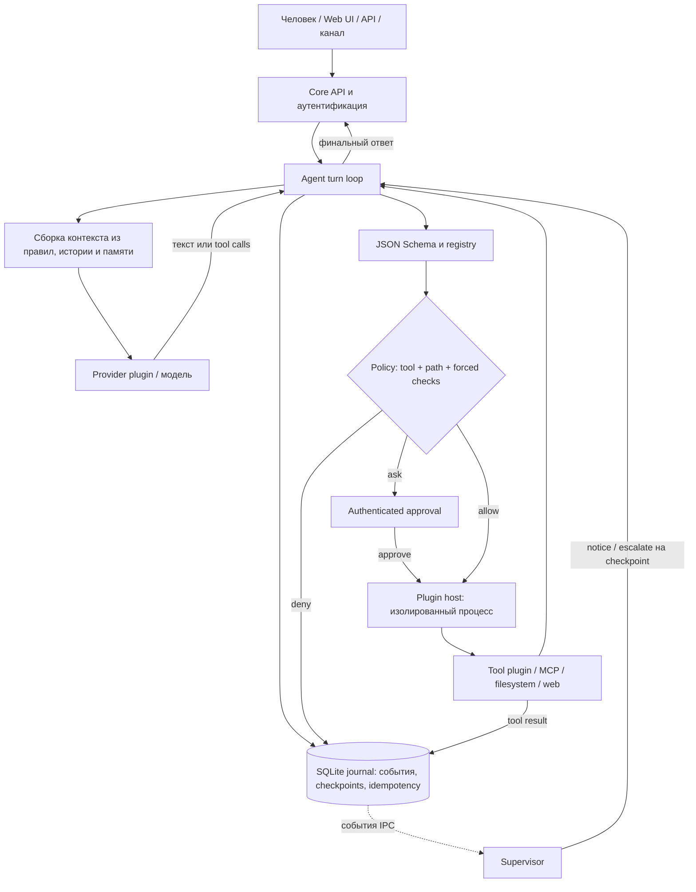

# Архитектура Sinty и обзор политик безопасности

Снимок проекта: 18 ноября 2026. Это архитектурное описание и статический разбор исходников, а не независимый аудит безопасности. Главные точки проверки: `packages/core/src/agent.ts`, `policy.ts`, `shell.ts`, `shell-sandbox.ts`, `host/host.ts`, `host/runner.ts`, `host/manifest.ts`, `packages/core/sandbox/ShellBox.cs` и спецификации `docs/spec/`.

## Короткий ответ

Да, архитектура в целом понятна: Sinty — локальный/самостоятельно размещаемый harness с долговечным журналом SQLite, циклом модели и инструментов в ядре, отдельными процессами плагинов и сменными интеграциями. Модель считается недоверенной; решения о правах принимает runtime. В проекте уже есть несколько хороших уровней защиты: схемы инструментов, политика `allow/ask/deny`, разрешения Node для плагинов, ограничения сети, отдельная клетка shell на Windows и bwrap на Linux, журналирование, budgets, а также неизменяемые правила для конфигурации и секретов.

Главный архитектурный риск — не отсутствие идеи безопасности, а разный фактический уровень защиты в разных средах и неодинаковая семантика разрешений. На Windows есть конкретная проблема: ACL, выдаваемые клетке для путей, не отзываются после команды. На Linux `standard + shell.sandbox:auto` продолжает работу без sandbox, если bwrap недоступен. На macOS OS-песочницы для shell нет. `mode: strict` также не означает одинаково строгую изоляцию всех инструментов на каждой ОС.

## Репозиторий: карта по областям

```text
sinty/
├── packages/
│   ├── core/                 ядро, turn loop, API, policy, journal, plugin host, sandbox
│   │   ├── src/              реализация ядра
│   │   ├── src/api/          HTTP/SSE и статические UI маршруты
│   │   ├── src/host/         запуск плагинов, IPC, манифесты, guarded fetch
│   │   ├── src/__tests__/    тесты runtime и security boundary
│   │   └── sandbox/          Windows ShellBox (C# / AppContainer)
│   ├── supervisor/           отдельный процесс наблюдения за событиями и остановками
│   ├── sdk/                  интерфейсы PluginContext, tools, events, memory и settings
│   └── cli/                  команды установки, запуска, doctor и управления
├── plugins/                  расширения и интеграции, каждый со своим manifest
│   ├── provider-*/           адаптеры моделей (Anthropic, OpenAI-compatible, Responses)
│   ├── tool-*/               возможности: файлы, веб, vision, audio, STT
│   ├── memory*/              внешние хранилища и обработчики памяти
│   ├── channel-*/             входящие/исходящие каналы
│   ├── server-*/              MCP, A2A, AG-UI, OpenAI API
│   ├── skills, delegate, scheduler, kanban, dynamic-tools, runtimes,
│   │   runninghub, site, diffusion, hyperframes, syntet, herdr, otel, usage
│   └── ui-web, context-inspector, responsive-turn и example-echo
├── apps/web/                  исходники интерфейса, собираемого в ui-web
├── schemas/                   JSON Schema публичных манифестов
├── docs/
│   ├── architecture.md        текущий обзор архитектуры
│   ├── spec/                  контракты API, политики, journal, plugin и памяти
│   ├── journal/               мотивация и история изменений
│   ├── research/              сравнительные обзоры и эксперименты
│   ├── roadmap.md, backlog.md, plan.md
│   └── integrations.md, migration-from-n8n.md
├── skills/                    встроенные инструкции для модели/агента
├── registry/                  каталог/метаданные плагинов
├── scripts/, build/, packaging/ сборка, стадирование, установка и выпуск
├── site/                      сайт проекта
├── vendor/                    сторонний код; не часть ядра Sinty
├── Dockerfile, install.*,      установка и упаковка
├── package.json, pnpm-*.yaml  монорепозиторий pnpm и общие команды
└── AGENTS.md, SECURITY.md, README* правила разработки, безопасность и вводная
```

Перечень `plugins/` приведён группами намеренно: это каталог компонентов верхнего уровня, а не инвентаризация всех файлов реализации. Внутри большинства плагинов лежат `sinty.plugin.json` (контракт и права), `package.json`, `src/`, README и иногда UI, тесты или ресурсы. Папки `dist/`, `node_modules/` и `vendor/` не следует принимать за первичный исходный слой проекта.

### Границы ответственности

| Слой | Основные файлы | Назначение |
|---|---|---|
| Публичные типы и контракты | `packages/sdk/src/`, `schemas/`, `docs/spec/` | Типы плагинов, инструменты, события, настройки и JSON Schema |
| Цикл агента | `packages/core/src/agent.ts`, `prompt.ts`, `coretools.ts` | Сборка контекста, вызов модели, проверка/запуск tool calls, пауза и resume |
| Журнал и восстановление | `journal.ts`, `blobs.ts`, `ids.ts` | События, сессии, turn/checkpoint, результаты и идемпотентность |
| Policy и секреты | `policy.ts`, `policy-trust.ts`, `secrets.ts`, `paths.ts` | Решения по инструментам и путям, системные запреты, secret refs и маскировка |
| Хост плагинов | `host/{host,runner,manifest,protocol}.ts` | Отдельный Node-процесс с разрешениями, IPC, валидация манифеста, доступ к сети и API |
| Супервизор | `packages/supervisor/`, `supervisor-client.ts`, `stall.ts` | Детектирование ошибок, циклов, бюджетов и зависаний; подсказка либо блокировка |
| Внешний API | `api/`, плагины `server-*`, `channel-*` | Клиенты общаются с ядром через HTTP/SSE/WebSocket или стандартные протоколы |
| Возможности | `plugins/` | Провайдеры, инструменты, память, UI, каналы и протокольные серверы |

## Как работает harness



1. Core принимает сообщение и связывает его с сессией/ходом.
2. Перед каждым model step контекст восстанавливается из журнала: правила и постоянные секции, summary/диалог, память и результаты инструментов. Контекстные плагины могут его дополнять.
3. Провайдер делает запрос модели. Вызовы инструментов сверяются с объявленным инструментом и JSON Schema.
4. Для каждого tool call применяется tool policy, известные path rules и дополнительные проверки конкретного инструмента. `ask` создаёт journal event и блокирует ход до решения аутентифицированного клиента.
5. Исполнение идёт через владельца инструмента, обычно отдельный plugin process. Результат или ошибка записываются в journal, после чего цикл продолжается.
6. Supervisor получает поток событий и на контрольных точках добавляет notice либо блокирует ход. Журнал остаётся основанием для resume после сбоя.

Это соответствует принципам из `docs/architecture.md`: журнал — источник истины, prompt является проекцией; core должен оставаться тонким; расширения — плагины; модель не является границей безопасности.

## Политика и песочницы: что действует сейчас

### Policy gate

- `policy.yaml` валидируется Zod-схемой в `config.ts`. Основные правила: `mode`, defaults по `sideEffects`, точечные/glob-правила инструментов, path rules, сетевые host allowlist, budgets, approval timeout и tool overrides по agent.
- `evaluateTool()` в `policy.ts` выбирает правило агента и инструмента, при этом явный `deny` выигрывает; если явного правила нет — берётся default по типу эффекта.
- `pathsTouched()` автоматически распознаёт пути только у ограниченного набора соглашений (`path` и имена tool вроде `fs.read`, `*.read_file`, `*.write`). Это дополнение к отдельной проверке инструмента, а не универсальный анализ произвольной схемы.
- Вызов shell дополнительно сканирует команду на упомянутые внешние пути и может запросить разовое read-only разрешение. Проверка командной строки эвристическая; реальная клетка должна обеспечивать границу независимо от парсера.
- Разрешение `ask` может быть одобрено только авторизованным API-клиентом; `session trust` для некоторых ask-правил осознанно снижает трение в пределах сессии. Принудительные проверки (например, patch прав плагина) выполняются отдельно.
- Сетевой вызов обычного плагина ограничен одновременно manifest permissions и `policy.yaml net.allow`. `ctx.net.public` идёт через core guard, который проверяет DNS/IP и redirects. Эти ограничения относятся к SDK-пути; сам shell и дочерние процессы — отдельная плоскость исполнения.
- Node permission model у plugin host ограничивает чтение/запись каталогами из манифеста. Это защита плагина от системы и соседних каталогов, но само по себе не изолирует ядро, если процесс ядра скомпрометирован.

### ОС-изоляция shell

| Платформа | Реализация | Фактическое свойство и ограничение |
|---|---|---|
| Windows | `ShellBox.exe`, AppContainer без capabilities, Job Object для убийства дерева процессов | Файловые права клетки выдаются через `icacls`; writable — рабочая папка, read-only — конкретные grants и каталог Node-инструментов. Нет сети через capability. ACL при этом остаются после завершения процесса (см. findings). |
| Linux | bubblewrap: namespaces, system directories read-only, workspace writable, пустой `/tmp`, очищенное env, network выключен по умолчанию | Хорошая клетка при успешном probe. `auto` при неудаче в `standard` запускает shell без неё с предупреждением; `strict`/`bwrap` отказывает. |
| macOS | `decideSandbox()` возвращает `none`; `runShell()` запускает системный shell как пользователь | Права процесса фактически равны правам пользователя; проверки путей по тексту команды не могут заменить OS boundary. |

`mode: strict` не является единым sandbox-профилем: на Linux оно делает bwrap обязательным и README описывает раздельных OS-пользователей для core/plugin. На Windows отдельный процесс AppContainer действует для shell, но режимы core/plugin следует понимать отдельно. На macOS строгая shell-клетка отсутствует. Поэтому отображаемый пользователю статус должен описывать эффективные свойства, а не только имя режима.

## Findings по ограничениям

### P1 — Windows AppContainer получает постоянные ACL

`packages/core/sandbox/ShellBox.cs` вызывает `icacls /grant` для AppContainer SID на рабочий каталог, Node tool directory и временно разрешённые каталоги, но код не восстанавливает исходные ACL. Профиль AppContainer имеет устойчивый SID (`Sinty.Shell`), поэтому ранее выданный SID доступ может сохраниться после команды и между вызовами. Это противоречит обещанию «грант только для этой команды»: пользователь отзывает разрешение в UI, но ACL может остаться. Также возникает накопление прав между запусками клетки.

**Исправление:** не менять ACL общих пользовательских каталогов в runtime. Сначала копировать/монтировать разрешённые входы в ephemeral sandbox root либо использовать отдельные временные копии/ACL с гарантированным restore в `finally`. Наиболее чистый вариант — уникальная клетка/идентичность на запуск, которую можно удалить целиком; проверить наследование ACL и гонки. Пока это не исправлено, grants за пределы workspace следует считать потенциально долговечными.

### P1 — Linux `auto` в standard молча сохраняет небезопасную возможность

При отсутствии bwrap или namespace probe код возвращает `kind:none`; `runShell()` всё равно запускает `spawn(..., shell:true)`. Warning — полезен, но предупреждение не меняет возможность чтения файлов/сети с правами процесса. Оператор может считать, что `auto` означает «если возможно изолировать», тогда как безопасная семантика обычно «изолировать или не запускать».

**Исправление:** сделать `auto` fail-closed для shell по умолчанию либо трактовать `standard` как sandbox-required и добавить отдельный явно подтверждаемый профиль «host shell». Предлагать понятную настройку установки/doctor для bwrap и проверять наличие доступной клетки до включения shell.

### P1 — macOS shell работает с полномочиями пользователя

Комментарий в `shell.ts` и реализация `decideSandbox()` подтверждают отсутствие sandbox на macOS. Эвристика `pathRefs()` ловит лишь некоторые буквальные абсолютные/относительные пути; она не ограничивает symlink traversal, shell substitution, glob expansion, переменные, интерпретаторы и поведение дочерних программ.

**Исправление:** добавить backend sandbox для macOS (например, отдельная VM/container runtime или поддерживаемая системная политика с тестами), либо отключать shell до появления надёжной клетки. Для комфортного local workflow предпочтителен управляемый контейнер с workspace mount, кэшем пакетов и preview-port proxy.

### P1 — shell network toggle слишком широк

Linux `shell.network: true` добавляет `--share-net`: весь дочерний процесс и произвольные команды получают сетевой доступ. `policy.net.allow` ограничивает `ctx.fetch` и core public-net path, но не обязательно произвольный socket из shell. Windows AppContainer без network capability ведёт себя по-другому, macOS вообще не изолирует.

**Исправление:** сетевой доступ shell должен идти через proxy с точным allowlist хостов, redirect/DNS/IP-проверками и журналированием, с брокером секретов, который не раскрывает реальные ключи дочернему процессу. Развести разрешения `fetch/http`, package registry и произвольные TCP сокеты.

### P2 — политика путей знает только ограниченную форму аргументов

`pathsTouched()` извлекает только `args.path`; для инструмента с `file`, `output`, массивом путей или составным destination policy не увидит путь автоматически. Это не обязательно обход защиты: plugin manifest/OS permission и собственный код инструмента могут закрывать доступ. Но операторская настройка `policy.paths` способна выглядеть шире/сильнее, чем реально является.

**Исправление:** добавить в контракт инструмента декларацию ресурсов (`resources: [{argument, access, resolver}]`) или стандартные typed path refs; валидировать её при загрузке, показывать эффективный preview и применять к нормализованному realpath после проверки symlink. Не полагаться на распознавание имён tool.

### P2 — `mode: strict` не описывает effective permissions

Режим объединяет разные механизмы: пользовательские аккаунты ОС, Node permission model, shell backend и настройки сети. Наличие `strict` не гарантирует одинаковых свойств на Windows/macOS/Linux; в конфигурации shell `off` предусмотрен явно. Пользователь может не понять, что именно стало сильнее/слабее.

**Исправление:** вместо одной метки показывать effective policy: shell isolation backend/version, writable mounts, network state, plugin process grants, secrets visibility, host identity; выдавать hard error для несоответствия заявленному профилю.

### P2 — гранулярность approval и доверия вызывает лишние/неясные вопросы

`ask` в основном применяется по side effect/tool/path и подтверждается на вызов; есть session «trust»/remember. Это надёжный базовый контроль, но неудобно для повторяющихся безопасных операций и недостаточно выразительно для действий уровня «только этот репозиторий/хост/команда». Долгоживущие гранты трудно отозвать/аудировать, а текст причины должен точно объяснять итоговую область.

**Исправление:** краткоживущие capability grants с scope, TTL, субъектом, ресурсом и журналом выдачи/отзыва; preset `workspace read`, `workspace write`, `network host`, `package install`, `external side effect`; единая панель «что агент реально может сейчас». Для действий irreversible/external — подтверждение отдельного действия, а не просто allow инструмента.

## Целевая модель: удобство без потери изоляции

1. **Control plane и execution plane отдельно.** Core, policy, secrets, journal, approval UI остаются на доверенной стороне. Агентский shell/tool исполняется в отдельной среде на задачу или сессию. Это близко к архитектуре OpenAI Agents sandbox: harness владеет маршрутизацией, review и журналом, compute — файлами и командами ([архитектура](https://developers.openai.com/api/docs/guides/agents-api/architecture), [sandbox security](https://developers.openai.com/api/docs/guides/agents-api/environments/security)).
2. **Единый контейнерный контракт:** workspace `/workspace` writable, inputs read-only по умолчанию, пустой home, временный `/tmp`, лимиты CPU/RAM/PIDs/disk/time/output, без host socket и без credentials. Persistent workspace — опциональная сессия с snapshot/restore; важный вывод сохраняется как артефакт.
3. **Сеть по умолчанию deny, но с удобным broker.** Дать разрешить хост/группу (GitHub, registry, конкретный API), не весь network namespace. Секреты остаются вне VM и добавляются доверенным proxy только к разрешённому destination. Эта схема соответствует рекомендациям разделять network restriction и approval и не передавать секреты коду агента ([OpenAI sandbox security](https://developers.openai.com/api/docs/guides/agents-api/environments/security)).
4. **Прозрачные профили работы:** `Review` (чтение, без shell side effects), `Workspace` (чтение/запись в проект, сеть deny), `Development` (контролируемые package registry/preview), `External actions` (отдельное подтверждение отправки/публикации/удаления). Это UX-пресеты над теми же capability правилами, не bypass.
5. **Не повторять одинаковые разрешения каждые 30 секунд.** Разрешение «npm install в текущем workspace из registry.npmjs.org до конца сессии» можно сохранить именно в пределах этой области и срока. Не превращать одобрение одной команды в доверие ко всему shell.
6. **Одинаковое поведение на ОС:** если backend среды отсутствует, показать конкретную причину, предложить установить/запустить совместимый runner. Не переходить незаметно на host privileges.
7. **Preview и аудит:** перед применением показать diff/файлы, сетевые destination и side effects; фиксировать решение, фактический запуск и результат как связанные journal events. Поддержать отмену и понятный статус «процесс и дети завершены».

### План внедрения по приоритету

| Этап | Работа | Почему |
|---|---|---|
| 0 | Немедленно устранить постоянные ACL ShellBox и добавить проверку удаления/изоляции выданного доступа | Конкретная граница прав сейчас не соответствует заявленной временности |
| 1 | Сделать sandbox availability обязательной для shell, добавить macOS backend/runner или fail-closed | Убрать платформенные варианты host execution по умолчанию |
| 2 | Ввести capability schema для tool resources и сетевых destination; UI effective grants | Policy станет предсказуемой, объяснимой и расширяемой |
| 3 | Добавить контейнерный execution provider с ресурсными лимитами, snapshot и артефактами | Упростить зависимости/пакеты/preview, не открывая host filesystem |
| 4 | Разделить решения approval по классу side effect и сроку; добавить revoke/review экран | Меньше повторных вопросов при сохранении узких грантов |
| 5 | Набор adversarial security regression scenarios на каждой ОС и проверка packaged runtime | Снизить риск расхождения между исходниками, стадированной сборкой и реальной средой |

## Сравнение с другими harness-подходами

- **OpenAI Agents / Codex environment:** чётко разносит harness, environment и application server; sandbox задаёт mounts, network и жизненный цикл. Отсюда полезно взять control-plane/execution-plane separation и повторно используемые templates/session state. Документация отдельно рекомендует ограничивать сеть и credentials; approval не заменяет сетевую политику ([architecture](https://developers.openai.com/api/docs/guides/agents-api/architecture), [self-hosted sandboxes](https://developers.openai.com/api/docs/guides/agents-api/environments/self-hosted), [security](https://developers.openai.com/api/docs/guides/agents-api/environments/security)).
- **Claude Code:** публичный CLI предлагает permission modes и отдельный опасный флаг обхода approvals. Sinty сильнее в декларативных tool/path/network rules и отдельном plugin runtime; полезный ориентир — не делать bypass обычным режимом и сделать пользовательские permission profiles понятными ([CLI reference](https://docs.anthropic.com/en/docs/claude-code/cli-usage)).
- **OpenHands:** в имеющемся исследовании Sinty от 27 октября есть сравнительные наблюдения по нескольким проектам, однако оно сделано по прежнему снимку кода и не заменяет актуальную проверку их текущей sandbox конфигурации. Здесь я не делаю новых точных утверждений о текущем OpenHands из непроверенного источника. Общий вывод для Sinty тот же: сначала чёткий контракт среды выполнения, затем расширение набора инструментов.

Sinty уже отличается сильной долговечностью состояния (журнал как источник истины), событийным resume, расширяемостью через плагины и supervisor loop. Улучшать стоит не переносом всей логики в большой core, а развитием узкого `ExecutionEnvironment` контракта: запуск команды, mount/capability profile, network broker, resource limits, cancel, snapshot/artifacts. Это сохраняет принцип «тонкое ядро, плагины для сменных вещей» при переносе критически важного enforcement на доверенный runtime/OS.

## Что уже сделано хорошо

- Чёткое разделение core и plugin surfaces; SDK/manifest дают место для расширений.
- Долговечный журнал, идемпотентность и восстановления после прерывания.
- Проверка tool args на границе и единый формат ошибок.
- Plugin process запускается с Node permission model и узкими filesystem grants; публичный fetch проходит несколько проверок.
- Approval приходит только от аутентифицированного клиента, а не из текста модели/плагина.
- Secret refs отделены от обычного контекста и есть редактирование чувствительных данных.
- Supervisor отслеживает циклы, бюджеты и stalls; пользовательские действия остаются через journal/API.
- Есть тестовые фикстуры и тесты для policy, plugin boundaries, network guard и shell.

## Ограничения этого обзора

Это чтение исходников и документации, а не запуск adversarial набора и не проверка собранных инсталляторов. Выводы сформулированы как review findings по конкретным путям исполнения. Перед тем как считать исправление оконченным, следует проверить упакованный ShellBox на Windows, bwrap на целевых Linux distributions и отдельный macOS backend, а также протестировать symlink, ACL inheritance, DNS/rebind, redirect, process cancellation и stale grants.

