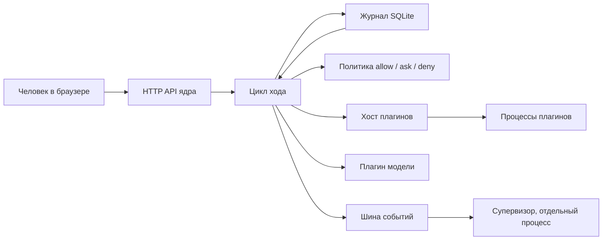
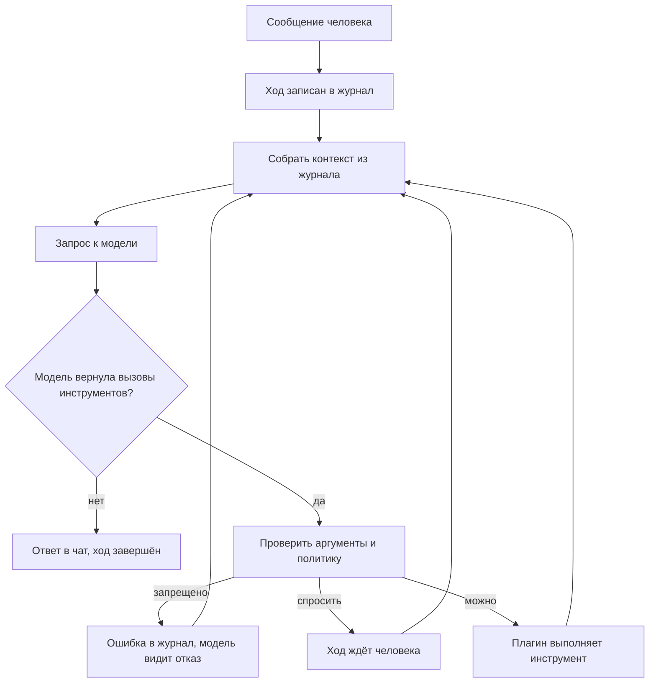
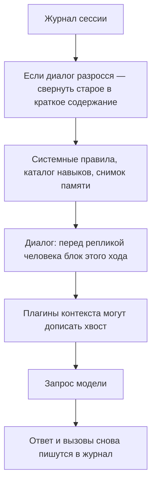
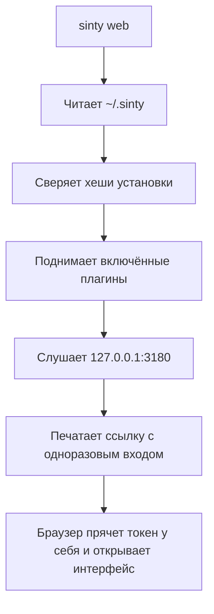
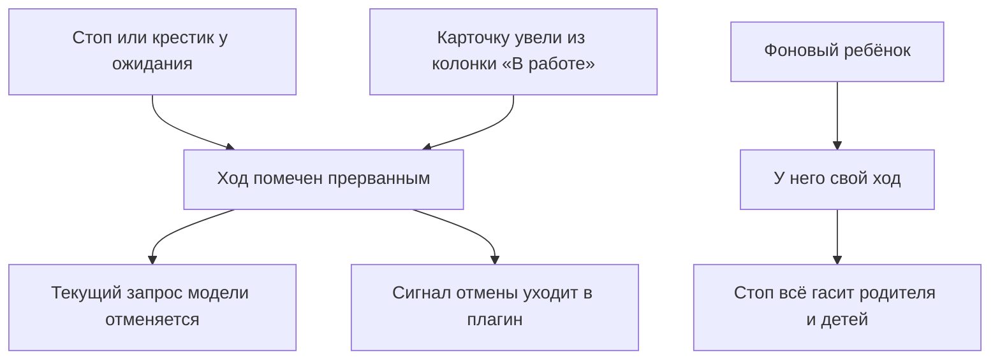

# Как устроен харнес Sinty

Сравнение с другими харнесами: [sinty-harness-comparison-2026-10-27.md](research/sinty-harness-comparison-2026-10-27.md).

Текст для мини-презентации. Харнес (harness) — оболочка, которая ведёт разговор с моделью, вызывает инструменты и хранит всё, что произошло. Модель здесь не начальник: она предлагает следующий шаг, а оболочка решает, можно ли его выполнить.

Если пункта из списка ещё нет, так и написано.

## Стек

| Слой | На чём | Зачем |
|---|---|---|
| Язык | TypeScript | Один язык у ядра, плагинов и веб-интерфейса |
| Среда | Node.js 24 | Процесс агента, права процессов, встроенный SQLite |
| Сборка | pnpm | Пакеты ядра, интерфейса и плагинов в одном дереве |
| Память на диске | SQLite, режим WAL (журнал пишется рядом, чтение не блокирует запись) | Журнал событий и встроенная память |
| Сеть наружу | HTTP и SSE (сервер шлёт события в открытое соединение) | Один протокол для браузера и любых других клиентов |
| Экран | Preact и Vite | Чат, канбан, календарь, настройки |
| Модели | Плагины протоколов | OpenAI-совместимый (DeepSeek, Grok и другие), Anthropic, OpenAI Responses |
| Секреты | AES-256-GCM, ссылки `secret://имя` | Ключ модели не попадает в текст для модели |

Ставится папкой. Домашняя папка по умолчанию `~/.sinty`. Веб слушает `127.0.0.1:3180`.

---

# 1. Архитектура и поток управления

## Карта компонентов и прав собственности

Ядро тонкое. В нём только то, без чего нельзя восстановиться после сбоя и нельзя удержать права.

Кто чем владеет:

| Место | Чьё | Что там |
|---|---|---|
| Папка установки | Только человек, на чтение | Ядро, супервизор, интерфейс. При старте сверяются хеши файлов |
| `config.yaml`, `policy.yaml`, `secrets.json`, `journal.db` | Ядро | Модели, права, ключи, журнал. Агент туда не пишет |
| `data/<плагин>/` | Один плагин | Например доска канбана и задания расписания |
| `skills/` и `workspace/` | Агент может писать | Навыки и файлы проекта |
| `plugins/` в домашней папке | Только через патч с проверкой | Свои плагины, не ядро |

Плагин (plugin) — отдельная программа со своим манифестом. Модель, файлы, веб, навыки, канбан, календарь, интерфейс — плагины. Ядро их запускает, перезапускает после падения и не отдаёт им чужие папки.

## Цикл «ход пользователя — модель — инструмент»

Ход (turn) — один заход от сообщения человека до ответа модели, внутри которого модель может несколько раз вызвать инструменты.

Политика на каждый инструмент: `allow` (сразу), `ask` (ход стоит, пока человек не решит), `deny` (нельзя). Запись в файлы по умолчанию спрашивает. Канбан и расписание в текущей политике разрешены сразу, иначе короткое «через 38 секунд» не успевало бы.

Результат инструмента возвращается модели, и цикл повторяется, пока модель не ответит текстом, не кончится бюджет или человек не остановит ход.

## Контекст, память, уплотнение и перезапуск

Контекст (context) — текст, который уходит в модель на одном шаге. Это не архив. Архив — журнал. Контекст каждый раз собирается из журнала заново.

Память (memory) — отдельные короткие записи, не сам чат. Три полки:

- профиль — всегда в подсказке, до 40 фраз;
- журнал памяти — последние 10;
- заметка — живёт 14 дней и всплывает только поиском.

Три области видимости: всем агентам, только этой роли, только этому чату.

Уплотнение (compaction) срабатывает на первом шаге хода, когда диалог занимает около 65% окна модели, но не позже потолка (по умолчанию 150 тысяч токенов, что меньше). Старые реплики заменяются кратким содержанием. Сам журнал не стирается. Если сводка не удалась, остаются последние реплики человека.

Перезапуск: каждый шаг записан до выполнения и после. Убитый процесс продолжает ход с того же места, повтор того же ключа не выполняет инструмент второй раз.

## Боты, субагенты, одноранговая доставка и планирование

Что уже работает:

- Субагент — инструмент `agent.task`. Дочерний чат делает кусок работы. Длинная или параллельная задача уходит в фон, родитель получает статус. Говорящий в дочернем чате наследуется от проекта.
- Канбан — доска проекта. В бэклоге назначение не стартует работу: открывается разбор. Дети ждут друг друга через зависимости. Родитель выходит в работу, когда дети в «Готово».
- Планировщик — три формы. `delaySeconds` — разово через N секунд. `at` — разово в момент. `cron` — повтор по минутам локальных часов, секунд в cron нет. Срабатывание пишет сообщение в чат и начинает новый ход. Пока процесс Sinty запущен, проверка раз в секунду.

Пока нет отдельной области:

- Боты Telegram и вебхук есть как плагины, в этой установке выключены.
- Одноранговая доставка агент-агенту (A2A) и делегирование во внешние CLI — плагины в дереве, не включены.
- Голосовой канал как отдельный продукт не включён.

## Пути запуска, аутентификации и управления

Токен (token) — пароль API. Его передают заголовком `Authorization`. В адресной строке он не остаётся. Смена токена гасит старый сразу везде.

Управление: настройки в интерфейсе пишут `config.yaml` и `policy.yaml`. Модель, список плагинов, лимиты, политика. Секреты задаются командой `sinty secret set`, в файл конфигурации попадает только имя.

На общем сервере задуман режим `strict`: ядро и плагины под разными пользователями системы. Сейчас рабочий путь — один процесс на машине человека. Отдельный адрес harness.syntet.ru ещё не поднимали.

## Граница отмены и исполнения

Отмена не стирает журнал. Уже записанный результат остаётся. Инструмент, который не смотрит на сигнал отмены, может дописать файл, но следующий шаг модели уже не начнётся.

Пока инструмент ждёт разрешения, ход в состоянии «ждёт». Это не ошибка и не новая задача.

---

# 2. Оперативное реагирование

Как из журнала собирается текст для модели.

## Порядок сборки и вставки

На каждом шаге, сверху вниз:

1. Системные правила этого чата и проекта. Зона статическая: не меняется от реплики к реплике.
2. Блоки плагинов в том же поясе. Сейчас это каталог навыков говорящего агента. Если блок не успел, повторяется прошлый удачный текст, а не пустота.
3. Снимок памяти и, если было уплотнение, краткое содержание. Зона сессии.
4. Диалог. Перед первой репликой человека в ходе стоит блок этого хода: время, найденные факты, что память узнала с прошлого раза.
5. Хвост от плагинов контекста, если они есть.

Следующие шаги того же хода не пересобирают блок хода: он уже лежит в журнале. Так повторный запрос отличается от первого только новым хвостом. Это нужно, чтобы провайдер мог взять начало запроса из своего кэша.

## Контракты текстов

Системный текст говорит, кто агент и какие у проекта правила (`AGENTS.md`). Он не доказывает права: права проверяет политика.

Навык (`SKILL.md`) — инструкция к делу, например как тимлид режет карточку канбана. В промпт попадает каталог, полный текст навыка модель читает инструментом.

Текст срабатывания расписания — приказ на этот ход: сделать то, что в `text`, и не обсуждать сам планировщик.

Память, пришедшая из чужого плагина, помечена как недоверенная. Встроенные факты — нет.

## Выученная память, общие области и privateMain

Области такие: `user` (все роли), `agent` (эта роль), `chat` (этот чат). Чужой чат и чужая роль свои факты не видят.

`privateMain` как отдельного хранилища нет.

Запись идёт через инструмент `memory.write`. Автопоиск в начале хода берёт текст человека и ищет факты (полнотекст и, если настроен маршрут эмбеддингов, вектор). Эмбеддинг (embedding) — числовой отпечаток фразы для поиска по смыслу, не по словам.

## Сводка: инструкция, носитель, срок жизни

Сводку пишет служебный вызов модели, не основной ход. Носитель — событие в журнале и блок в начале диалога. Исходные реплики в журнале остаются. Сводка обновляется при следующем уплотнении, а не живёт вечно отдельным документом. Факты, извлечённые из сводки, идут обычным путём записи памяти.

## Субагенты и перекличка

Субагент не болтает с родителем свободно. Он работает в своём чате. Родитель видит статус, одобрения и итог. Сообщение канбана в общий чат проекта — заметка доски, не новая задача. Отдельной ленты «агенты переписываются между собой» нет.

## Голос, схемы бэкенда и необязательные границы

Голосового рабочего стола нет. Схемы есть у инструментов: каждый инструмент описывает вход JSON Schema, ядро отвергает кривой аргумент до запуска.

Необязательные границы, которые уже можно выключить: плагины в списке `plugins.enabled`, навыки на карточке агента, политика на инструмент, маршрут модели, потолок уплотнения, дневной бюджет плагинов.

---

# 3. Скорость, запросы и токены

Токен (token) здесь — кусок текста, которым модель меряет счёт. Это не пароль входа.

## Фактические запросы, не оценки

Каждый вызов модели пишет `usage.recorded`: сколько токенов входа и выхода вернул провайдер. Это числа счёта, не догадка ядра. Служебные вызовы (сводка, картинка, эмбеддинг) пишутся так же, с пометкой, кто их сделал.

Оценка размера нужна только чтобы решить, пора ли уплотнять и влезает ли запрос в окно. Для этого ядро помнит отношение «наши символы / токены провайдера» по прошлым ответам.

## Базовая инструкция и полный запрос — разные измерения

Базовая инструкция — системный текст и каталог навыков. Она повторяется. Полный запрос — она плюс память, сводка, весь диалог и схемы инструментов. Счёт провайдера относится к полному запросу. Поэтому короткий ответ человека может стоить дорого, если под ним длинная история и много инструментов.

## К чему это ведёт

Повторяющееся начало запроса держат стабильным, чтобы провайдер кэшировал его. Уплотнение режет середину диалога, а не правила. Картинки ходят пачками, а не по одной. Длинная работа уходит в фон, чтобы человек не ждал один ход. Короткий таймер не спрашивает разрешение, потому что вопрос длиннее паузы.

## Как вход или работа разрастаются

- Длинный чат до порога уплотнения.
- Много инструментов в схеме: каждый описан в запросе.
- Вложения и пачки картинок.
- Фон: каждый ребёнок — свой запрос модели.
- Расписание: каждое срабатывание — новый ход.
- Память и сводка добавляют блоки, но обычно меньше, чем сырой диалог.

## Что ускоряет и что может замедлить

Ускоряет: кэш начала запроса, один поиск памяти на ход, уплотнение, пачка картинок, фон вместо одного гигантского хода.

Может замедлить: частый тик расписания (раз в секунду смотрит список, это дёшево, пока заданий мало), супервизор на каждом событии, снимок контекста для вкладки «Контекст», слишком низкий потолок уплотнения (лишние служебные сводки).

## Что происходит после ответа

Ответ уже в журнале. Дальше асинхронно дорабатывают обработчики памяти (`afterTurn`): они не держат человека. Расписание и канбан могут открыть следующий ход сами. Супервизор может оставить заметку, и она попадёт в следующий контекст.

## Объяснения, которые не пережили проверку

- «Назначение исполнителя сразу ставит карточку в работу». Нет: в бэклоге сначала разбор.
- «Цели держат очередь». Нет: очередь держит исполнитель, проверяющий и зависимости.
- «Есть таймер на секунды отдельно от календаря». Нет: это тот же планировщик, поле `delaySeconds`.
- «Cron умеет 38 секунд». Нет: cron только с точностью до минуты.

## Тесты, разбор и что сохраняют

Сборка TypeScript и тесты ядра. Золотые тексты промпта сравнивают байты: случайная правка памяти не должна менять запрос. Журнал изменений и `docs/journal` хранят, почему решение такое. Хеши установки не дают подменить файл ядра молча.

## Что по-прежнему отвечает на «почему»

Почему модель «сама» не написала через 38 секунд: она не вызвала инструмент, а секунд в cron нет. Почему карточка не поехала: не было проверяющего или не закрыты зависимости. Почему после сбоя чат жив: ответ лежит в журнале, а не в памяти процесса.

## Рамки и сохранённые контрпримеры

Рамка презентации — один процесс на машине, включённые плагины: модель, файлы, веб, зрение, навыки, канбан, расписание, интерфейс. Не входят выключенные каналы и чужой хост.

Контрпримеры, которые легко перепутать: остановка хода не удаляет файлы, которые инструмент уже записал. Разрешение `schedule.*` не разрешает произвольную запись на диск. Сводка не заменяет журнал.

## Закреплённые артефакты

Отдельных «пинов артефактов» для сравнения сборок нет. Ближайшее: коммит `02f3a18` на `main` (канбан, календарь, задержка в секундах) и хеши `integrity.json` установленной папки.

## Якоря в коде

- Цикл хода: `packages/core/src/agent.ts`, сборка `buildContext`.
- Память: `docs/spec/memory.md`, `memory-router.ts`.
- Политика: `packages/core/src/policy.ts`.
- Планировщик: `plugins/scheduler/src/index.ts`.
- Канбан: `plugins/kanban/src/index.ts`.
- Карта ядра: `docs/architecture.md`.
