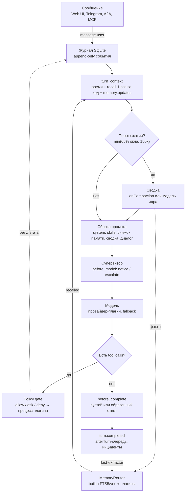
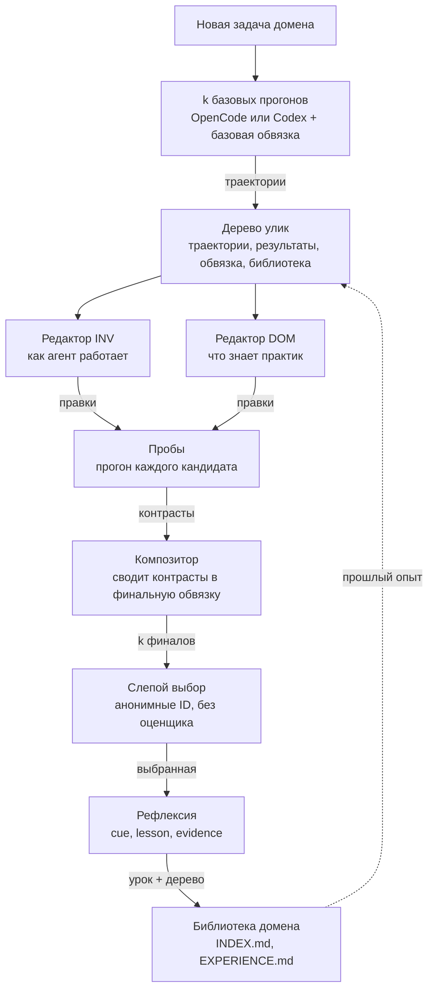
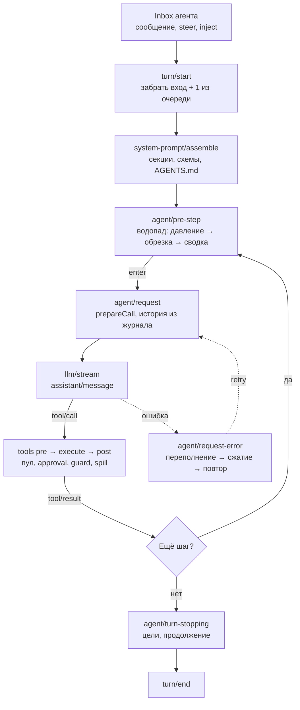
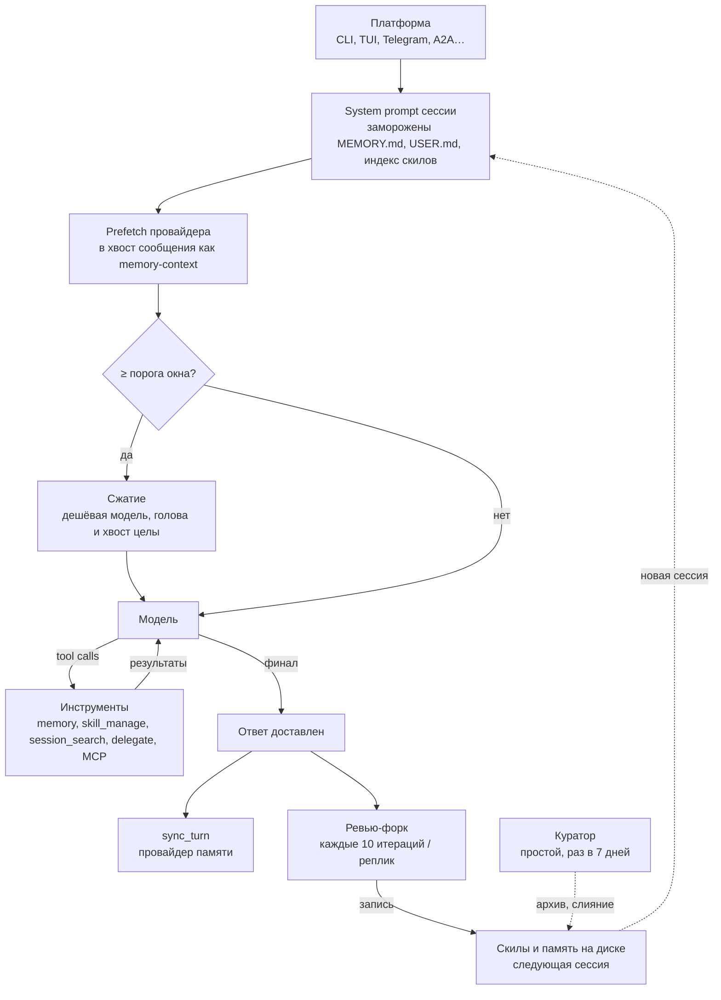
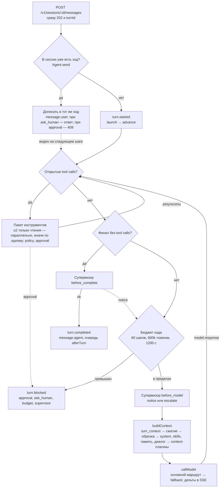
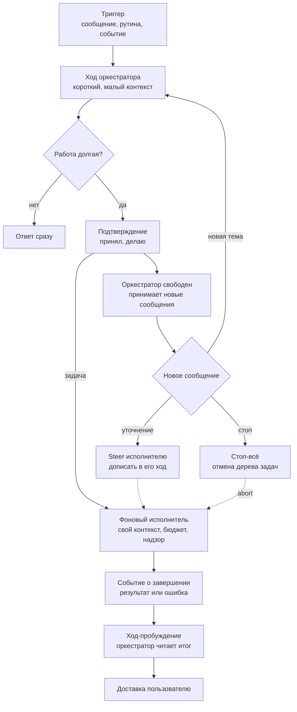

# Sinty и другие харнесы: сравнение по слоям

**Кратко:** Как устроены ядро, память, контекст, скилы, плагины, самообучение и мультиагентность в Harness², DeepSeek Harness и Hermes Agent, чем это ценно и что из этого взять в Sinty.

**Дата экспорта:** 2026-10-22 (Europe/Moscow)  
**Источник (Page):** https://cursor.com/canvas/store-0704a163-5856-4e6a-8845-731430394238/34335aa1-7854-4a35-a178-bacdc4e72994

## Оглавление

1. [Что проверено](#что-проверено)
2. [Сводная таблица по слоям](#сводная-таблица-по-слоям)
3. [Sinty сегодня](#sinty-сегодня)
4. [Harness² (Google Research)](#harness²-google-research)
5. [DeepSeek Harness](#deepseek-harness)
6. [Hermes Agent (Nous Research)](#hermes-agent-nous-research)
7. [Самообучение: три механизма](#самообучение-три-механизма)
8. [Мультиагентность внутри и между харнесами](#мультиагентность-внутри-и-между-харнесами)
9. [Паттерны Grok Bot, видимые снаружи](#паттерны-grok-bot-видимые-снаружи)
9a. [Разбор харнеса Grok Bot по гисту](#разбор-харнеса-grok-bot-по-гисту)
10. [Ход Sinty против отзывчивого хода](#ход-sinty-против-отзывчивого-хода)
11. [Итог для Sinty](#итог-для-sinty)
12. [Новые идеи](#новые-идеи-которых-я-не-нашёл-ни-в-одном-из-трёх)
13. [Источники](#источники)

---

## Что проверено

| Цель | Существует | Что это на самом деле | Версия |
| --- | --- | --- | --- |
| google-research/harness2 | да | Harness²: рекурсивная оптимизация обвязки, Python, Apache 2.0 | `1cfe254`, 14.10.2026 |
| deepseek-ai/deepseek-harness | да | DeepSeek Harness (`dsh`): «Everything is a Plugin», TypeScript, MIT | `687f282`, 17.10.2026 |
| nousresearch/hermes-agent | да | Тот же репозиторий, что NousResearch/hermes-agent; Python, MIT | `7b9cb2e`, 22.10.2026 |
| gist gfsaaser24/9f785c0… | да | Не харнес: неофициальный разбор устройства Grok Bot третьим лицом | `81a9f86`, 19.09.2026 |
| Sinty (maxseo/sinty) | да | Ваш харнес, main после PR #19 | `d7609e6` |

> **Про гист.** Это реконструкция по скомпилированному JavaScript, которую написал сторонний автор. Её точность не подтверждена: сам текст помечает часть связей как непроверенные. Раздел «видимые снаружи» по-прежнему только про поведение. Отдельный раздел ниже пересказывает указанные слои этой реконструкции и сравнивает их с Sinty. Это не исходники xAI.

Все утверждения ниже опираются на исходники и документацию из клонов (даты коммитов указаны по Москве). Пути даны от корня репозитория. Где вывод мой, а не из кода, это помечено словом «вывод». Цифры результатов Harness² взяты из README и в рамках этой работы не перепроверялись.

---

## Сводная таблица по слоям

### Ядро и контекст

| Слой | Sinty | Harness² (Google) | DeepSeek Harness | Hermes Agent (Nous) |
| --- | --- | --- | --- | --- |
| Что это | Личный агент-сервер на Node 24, тонкое ядро + плагины в отдельных процессах | Не агент, а внешний оптимизатор обвязки поверх OpenCode или Codex | Агент-платформа на Cordis: всё, включая цикл, — плагин | Монолитный агент на Python с плагинами, шлюзом в мессенджеры и десктопом |
| Цикл хода | context.build → модель → инструменты → повтор; журнал SQLite — источник правды | Цикл исполнителя чужой; свой цикл — Propose–Probe–Compose над обвязкой | turn → step; каждая фаза — событие-водопад (`agent/pre-step`, `agent/request`, `tools/*`) | `conversation_loop` с подготовкой итерации, финализатором и фоновыми форками |
| Стоп и бюджеты | Нет tool calls; бюджет шагов и токенов; блок супервизором; прерывание | 4k прогонов и 3k стадий на режим; невалидная правка — 1 повтор, потом наследование | Нет долга инструментов; `agent/turn-stopping`; цели до 256 раундов | `max_turns: 500` в примере конфига; бюджетные предупреждения |
| Надзор | Отдельный процесс-супервизор: детекторы, лестница эскалации, память инцидентов | Валидация дерева обвязки, лимит always-on 24 000 символов, защита от утечки оценок | `repeat-tool-reminder`, `timeout-policy`, экспериментальный Auto review | Защита от петель ботов, сторож стримов, ревью-агент по `/review` |
| Контекст | Сжатие при min(65% окна, 150k), 12 последних реплик, ступенчатая обрезка, кэш-инварианты | Только лимит always-on текста; окно — забота исполнителя | Порог min(0.8W, W−O−64K), хвост 16%, сначала обрезка результатов, spill в файлы | Порог 50% (не ниже 75% при окне <512K), дешёвая модель сжимает середину |

### Память

| Слой | Sinty | Harness² (Google) | DeepSeek Harness | Hermes Agent (Nous) |
| --- | --- | --- | --- | --- |
| Хранилище | SQLite: факты (profile, log, note), FTS5 + sqlite-vec, области user / agent / chat | Библиотека опыта по домену: INDEX.md + полная обвязка + EXPERIENCE.md | Встроенной долговременной нет: AGENTS.md, поиск по сессиям (эксп.), MCP-серверы памяти | MEMORY.md (2200 симв.) + USER.md (1375 симв.) + SQLite-сессии с FTS5 + 1 внешний провайдер |
| Когда пишется | Инструмент `memory.write`, факты из сводки, очередь afterTurn (fact-extractor) | После задачи: рефлексия выбранной обвязки → cue, lesson, evidence, confidence | Нет автозаписи; журнал сессии — append-only события | Инструмент `memory`; фоновый ревью-форк каждые 10 реплик; `sync_turn` провайдера |
| Что читается | Снимок памяти (сессия), recall один раз за ход в `turn_context`, `memory.updates` | Библиотека домена копируется в контекст редактора следующей задачи | Цепочка AGENTS.md до 64 КБ в первом запросе, новые файлы по мере чтения | Замороженный снимок в system prompt; prefetch провайдера в хвост сообщения |
| Ранжирование | RRF по FTS и векторам с затуханием по возрасту; стемминг ru/en | Нет: отбор по домену «по построению» | Зависит от MCP-сервера | BM25 FTS5 с понижением cron-сессий; ранжирование провайдера |

### Плагины и коннекторы

| Слой | Sinty | Harness² (Google) | DeepSeek Harness | Hermes Agent (Nous) |
| --- | --- | --- | --- | --- |
| Плагины | Манифест `sinty.plugin.json`, 9 видов точек расширения, процесс на плагин | 8 редактируемых компонент обвязки, плагины OpenCode как middleware | Профили, бандлы и патчи Cordis; любая строка заменяема | ABC и хуки; «плагины не трогают ядро»; каталог внешних плагинов |
| Скилы | Плагин `skills`: каталог в system-секции, `skill.write` и правка | Скилы — компонент обвязки, который оптимизатор пишет сам, с авто-триггером | Реестр провайдеров скилов (ФС, пакеты, удалённые) + инструмент `skill` | Прогрессивное раскрытие `skills_list` / `skill_view`, хаб из нескольких источников |
| Коннекторы | server-mcp, server-a2a, OpenAI API, AG-UI; MCP-клиента пока нет | Нет; доступ к сети у исполнителя | MCP-клиент (stdio, HTTP), ACP-сервер, вебхуки, расписание | MCP-клиент с OAuth, mcp-serve, ACP, A2A, 25+ платформ |

### Обучение и агенты

| Слой | Sinty | Harness² (Google) | DeepSeek Harness | Hermes Agent (Nous) |
| --- | --- | --- | --- | --- |
| Самообучение | Память инцидентов + патчи плагинов с тестами и откатом; навыки только вручную | Главное: переписывает всю обвязку под задачу и копит уроки домена | Почти нет: цели, Ralph-циклы, отзывы пользователя | Главное: ревью-форк пишет скилы и память, куратор чистит библиотеку |
| Субагенты | `agent.task`: один дочерний ход, глубина 1, блокирующий, до 12 инструментов | Субагенты — редактируемый компонент; параллельные прогоны кандидатов | Единый API: свежий, форк, Claude Code, Codex, ACP, SDK; workflow-скрипты | `delegate_task`: до 10 параллельно, глубина 1 по умолчанию, фоновый режим |
| Между агентами | A2A и MCP сервером, delegate в CLI, kanban, herdr | Через исполнителей (OpenCode/Codex) | Agent Teams: ростер, почта, доска задач; ACP в обе стороны | Kanban-доска между профилями, A2A v1.0, send_message в любые каналы |

---

## Sinty сегодня

### Схема хода

### Ядро и надзор

- Цикл в `packages/core/src/agent.ts`. Инструменты только для чтения идут параллельно (`canRunTogether`), остальные по одному. Каждый вызов проходит схему, policy gate и журнал с ключом идемпотентности.
- Супервизор работает отдельным процессом без сети и без права записи (`docs/spec/supervisor.md`). Он проверяет ход в двух точках: перед вызовом модели и перед финальным ответом. У него 8 работающих детекторов (девятый, `provider`, в плане) и лестница из 4 уровней: подсказка, смена стратегии, патч, человек.
- Самопочинка — это `plugin.propose_patch`: правка в копии, прогон тестов, затем `apply_patch` с горячей перезагрузкой и автоматическим откатом. Права меняются только с подтверждением человека.

### Память и контекст

- Запись идёт тремя путями: `memory.write`, факты из сводки при сжатии и очередь afterTurn (`fact-extractor` на дешёвом маршруте). Уровни: profile (до 40 записей, всегда в промпте), log (10 свежих), note (живут 14 дней, только через recall).
- Чтение: снимок памяти пишется в журнал один раз на сессию. Recall выполняется один раз за ход внутри `turn_context`, новые факты приходят однократно через `memory.updates`. Весь путь устроен так, чтобы префикс оставался в кэше.
- Поиск: FTS5 со стеммингом и sqlite-vec, слияние через RRF с затуханием по возрасту. Векторы выключены, пока не задан `models.routes.embed`.
- Есть то, чего нет ни у кого из трёх: теневые эксперименты с памятью и `sinty memory eval` (`docs/spec/memory.md`).

### Сильные стороны

- Журнал как источник правды: память и сжатие можно сломать без потери данных
- Супервизор вне досягаемости агента и патчи с канареечным откатом
- Кэш-инварианты закреплены «золотыми» тестами
- Память подключаемая, с таймаутами, запасным путём и экспериментами

### Слабые стороны

- Нет цикла, который превращает опыт в скилы
- `agent.task` блокирующий, один ребёнок, без фона
- Нет MCP-клиента; сообщение во время хода ждёт текущий инструмент
- Нет поиска по сырым прошлым сессиям: `context.recall` ищет только внутри текущей

---

## Harness² (Google Research)

### Схема хода

### Как устроено

- Это мета-уровень. Ход агента выполняет OpenCode или Codex (`harness2/substrate/`), а Harness² оптимизирует саму обвязку: system prompt, guardrails, память, гайд по инструментам, субагентов, скилы, скрипты и плагины (8 компонент, `harness2/core/tree.py`).
- Уровень задачи: два редактора, INV («как агент работает») и DOM («что знает практик»), предлагают правки по траекториям базовых прогонов. Каждая правка обкатывается пробным прогоном, композитор сводит контрасты, затем слепой селектор выбирает финал по анонимным ID (`recursion.py`, `selection.py`).
- Уровень харнессинга: после выбора рефлексия выделяет урок (cue, lesson, evidence, confidence). Урок вместе с полной обвязкой ложится в библиотеку домена (`library.py`). Следующая задача этого домена получает библиотеку в контекст редактора.
- Память агента в базовой обвязке — файл LongTermMEMORY.md, который всегда в промпте (`third_party/jb_runner/harness_baseline_oc/`). Лимит always-on текста 24 000 символов, потому что «каждый токен конкурирует с выводом» (`substrate/opencode.py`).
- Ограничители: правки валидируются, невалидная получает один повтор, а затем остаётся прежняя обвязка. Есть проверки, что в улики не утекли вердикты оценщика (`context.py`). Ground truth не используется.

### Почему это ценно

- Обвязку улучшают без дообучения весов: по README +11.5 на WorkBuddy-Bench, +4.5 на JobBench и +11.8 п.п. на LAB за один шаг.
- Сигнал обучения — контраст двух прогонов одной задачи, а не оценка. Так можно учиться и там, где правильного ответа нет, как у личного агента.
- Урок хранится вместе с доказательством (evidence) и уверенностью. Это защищает от «суеверий», которые копятся в памяти.

> **Взять в Sinty.** Офлайн-цикл «предложить правку конфигурации, промпта или скила → прогнать на повторе журнала → выбрать вслепую». В Sinty уже есть почти всё для этого: журнал, теневые эксперименты и `memory eval`.

---

## DeepSeek Harness

### Схема хода

### Как устроено

- Ядра в привычном смысле нет. На Cordis плагинами сделаны даже журнал сессии, сборка промпта, реестр инструментов и сам цикл (`docs/architecture.md`). Каждая возможность — шов из трёх ролей: определение, провайдер и потребитель (`docs/capability-seams.md`).
- Ход состоит из шагов, а точки расширения — события-водопады, где слушатель вызывает `next()`. Steering и внедрённый контекст приходят через единый inbox и попадают в следующий шаг (`docs/agent-lifecycle.md`).
- Сжатие — отдельный плагин (`packages/compaction/compaction-basic`). Порог считается как floor(min(0.8W, W − O − 65 536)), дословно хранится свежий хвост в 16% от W − O. До суммаризации запускается дешёвая обрезка больших результатов. При ошибке переполнения выполняется максимальное сжатие и повтор. Сводка записывается в журнал как `compaction/summary` с полным вызовом, так что её можно воспроизвести.
- Spill: большой результат инструмента сохраняется в файл дословно, а модель получает локатор и подсказку, как его прочитать (`docs/subsystems/spill.md`).
- Своей долговременной памяти нет. Есть цепочка AGENTS.md (до 65 536 байт, вложенные файлы подгружаются по мере работы), экспериментальный поиск по прошлым сессиям и готовые конфиги для сторонних MCP-серверов памяти, выключенные по умолчанию (`docs/user/guide/mcp-memory.md`).
- Субагенты: один API на все бэкенды (свежий ребёнок, форк, Claude Code, Codex, ACP, SDK). Workflow-скрипты, которые пишет модель, запускают субагентов в песочнице (`docs/subsystems/workflow.md`). Agent Teams дают лида, именованных напарников, почту и доску задач (`docs/subsystems/agent-team.md`).

### Почему это ценно

- Любую часть, включая цикл, можно заменить конфигом, не форкая код. Это предельная версия вашего принципа «всё плагины».
- Восстановление после переполнения и spill убирают два частых сбоя длинных сессий: падение запроса и потерю данных при обрезке.
- Делегирование в чужие харнесы (Claude Code, Codex, любой ACP-агент) — штатный бэкенд, а не отдельный инструмент.

> **Взять в Sinty.** Spill больших результатов вместо безвозвратной обрезки, очередь inbox со steering, восстановление по ошибке переполнения и единый интерфейс субагента с бэкендами «свой ребёнок / delegate CLI / A2A».

---

## Hermes Agent (Nous Research)

### Схема хода

### Память: что, куда, когда

- Встроенная память — два файла. MEMORY.md (по умолчанию 2200 символов) хранит факты о среде, USER.md (1375 символов) — профиль пользователя. Каждый факт должен попасть ровно в одно место (`tools/memory_tool.py`, `agent/background_review.py`).
- Снимок обоих файлов замораживается в system prompt при старте сессии. Записи посреди сессии идут на диск, но промпт не меняют, чтобы не ломать кэш. Видны они станут только в следующей сессии.
- Внешний провайдер ровно один (`agent/memory_provider.py`). `prefetch` выполняется до хода с таймаутом, результат дописывается в хвост текущего сообщения как блок memory-context (`agent/turn_context.py`). После хода вызывается `sync_turn`. Есть хуки `on_pre_compress`, `on_session_end`, `on_delegation` и `on_memory_write`.
- Можно включить `checkpoint_required`: тогда сжатие без подтверждённого чекпойнта памяти запрещено, и стенограмма сохраняется (`cli-config.yaml.example`).
- `session_search` ищет FTS5 по всем прошлым сессиям в SQLite без вызова модели. Cron-сессии понижены, чтобы не забивать выдачу (`tools/session_search_tool.py`).

### Самообучение

- После доставки ответа фоновый форк агента перечитывает разговор и решает, что сохранить. Скилы проверяются каждые 10 итераций с инструментами, память — каждые 10 реплик пользователя (`agent/agent_init.py`, `agent/turn_finalizer.py`). Форк использует тот же кэш префикса, по комментарию в коде это около 30K токенов за раз.
- Промпт ревью явно запрещает сохранять сбои окружения, отрицательные утверждения об инструментах («X не работает») и неудачные попытки под видом рецепта (`_DO_NOT_CAPTURE_BLOCK`).
- Куратор запускается в простое, раз в 7 дней. Скил устаревает через 14 дней без использования и архивируется через 30. Ничего не удаляется, закреплённые скилы не трогаются, слияние скилов моделью включается отдельно (`agent/curator.py`).

### Почему это ценно

- Агент реально учится на пользователе: исправления стиля и порядка работы становятся правилами скилов, и следующая сессия начинает уже с ними.
- Явный список «чего не запоминать» закрывает главный провал самообучения: агент перестаёт ссылаться на давно починенную поломку.
- Лимиты в символах держат память в рамках: агент вынужден сжимать её, а не копить.

> **Взять в Sinty.** Фоновый ревью после хода, который пишет скилы через существующий `skill.write`, список «не запоминать», куратор с архивом вместо удаления и поиск по прошлым сессиям.

---

## Самообучение: три механизма

|  | Sinty | Harness² | Hermes |
| --- | --- | --- | --- |
| Сигнал | Детектор супервизора: сбой и последующий успешный вызов | Контраст прогонов одной задачи | Ревью разговора моделью |
| Триггер | Конец хода (инциденты), 3 хода со сбоями (патч) | Каждая задача | Каждые 10 итераций или реплик, простой для куратора |
| Что меняется | Таблица инцидентов, код плагина | Вся обвязка + библиотека уроков | Скилы, MEMORY.md, USER.md |
| Проверка | Тесты в копии, канарейка, откат | Пробный прогон и слепой выбор | Только промпт ревью и линтер скилов |
| Цена | Почти ноль, детерминированно | Высокая: 4k прогонов на задачу | Около 30K токенов за ревью (комментарий в коде) |

Вывод: у Hermes самая широкая петля обучения, но без проверки результата. У Harness² самая строгая проверка, но она дорогая. Sinty дешёв и проверяем, но учится только чинить плагины. Сильнее всего было бы соединить триггер Sinty, запись Hermes и проверку Harness².

---

## Мультиагентность внутри и между харнесами

|  | Sinty | Harness² | DeepSeek | Hermes |
| --- | --- | --- | --- | --- |
| Внутри | `agent.task`, персоны roster и проекты с лидом | Редакторы, композитор, селектор, рефлектор — отдельные сессии модели | Субагенты, workflow-скрипты, Agent Teams с почтой | `delegate_task` пачкой, фоновые дети, MoA, kanban-воркеры |
| Параллельность | Только инструменты чтения | Пробы в пуле потоков | Пул инструментов, параллельные дети | До 10 детей, фоновые |
| С чужими агентами | delegate (Claude Code, Codex, Grok CLI), A2A и MCP сервером | Исполнители OpenCode и Codex | ACP в обе стороны, Claude Code, Codex | A2A v1.0 в обе стороны, ACP, send_message |
| Общая координация | kanban, herdr | Ledger прогонов | Доска задач команды | SQLite-доска между профилями с CAS-захватом |

---

## Паттерны Grok Bot, видимые снаружи

Только поведение, которое видит пользователь, без внутреннего устройства. Каждый пункт соотнесён с тем, чего не хватает Sinty.

| Паттерн | Что даёт | В Sinty |
| --- | --- | --- |
| Фоновые исполнители, чат остаётся отзывчивым | Длинная работа не блокирует разговор | Нет: `agent.task` блокирует ход; сообщение ждёт текущий инструмент, при ожидании подтверждения — 409 |
| Рутины по расписанию и событиям | Агент работает без запроса | Точка `schedule` есть только в плане |
| Общая библиотека скилов для нескольких ассистентов | Один раз научился — пользуются все | Скилы общие на установку, но новые сами не появляются |
| Коннекторы к сервисам пользователя | Действия в реальных системах | Серверы есть, MCP-клиента нет |
| Общая память пользователя для всех ассистентов | Не нужно повторять себя | Есть: область `user` видна всем персонам |
| Агенты-пиры пишут друг другу | Разделение труда без человека | Частично: A2A, kanban |

---

## Разбор харнеса Grok Bot по гисту

Источник: [gist gfsaaser24, раздел Architecture and control flow](https://gist.github.com/gfsaaser24/9f785c0c095b693b31b5efbcbae7bcd0#architecture-and-control-flow), снимок `81a9f86`. Это разбор скомпилированного `host-main.cjs` (сборка `17e335e`) и отдельно десктопа `.52`. Автор сам пишет, что стрелки — найденные вызовы, а не прогон живой системы, и что пара десктоп↔хост не доказана. Ниже только запрошенные слои. Где вывод мой, это помечено.

### Architecture and control flow

Хост («коробка») крутит агента. Десктоп — окно, аккаунты и инструменты на машине человека. Демон исполнения отдельно от цикла. Воркеры блобов хранят разговор, но это не «своя VM на бота». Цикл модели остаётся на хосте, даже если инструмент уходит на выбранный компьютер. Оценка (eval) — отдельный вход в тот же раннер.

| Часть | По гисту | Sinty |
| --- | --- | --- |
| Кто владеет ходом | Хост: шлюз → допуск сообщения → очередь на агента → раннер → цикл | Ядро в одном процессе `sinty web`; плагины — отдельные процессы |
| Где лежат данные | Разные хранилища: журнал допуска, блобы разговора, шарды памяти, файлы скилов | Один SQLite-журнал как правда; блобы и `_inbox` рядом; память в своём SQLite |
| Куда едет инструмент | Выбор машины: локальный демон, коробка, MCP или чужой сервис | Инструмент плагина на этой же машине; выбора «чужого компьютера» нет |
| Eval | Тот же раннер, файл запроса, можно выключить инструменты и подменить время | `sinty memory eval` есть; полного прогона хода из файла нет |

Вывод: разделение «окно / цикл / исполнение» у них жёстче. Sinty уже отделяет плагины и супервизор, но цикл, API и запись файлов живут в одном процессе.

### User turn and model/tool loop

Перепроверка по гисту. Ход такой:

1. Отправка (`sendPrompt`) сразу подтверждается и показывается в чате. Запись в журнал может не успеть: при залоченной базе сообщение принимают и пишут, что оно не долговечно. У Sinty наоборот: событие сначала дописывается в журнал, и только потом ход идёт дальше. Это сильнее, копировать их развилку не стоит.
2. На агента одна очередь. Раннер собирает профиль, инструменты и два сеанса модели: основной и сеанс сводки.
3. Шаг: поток модели → если есть вызовы, разрешение инструмента, права, исполнение → результат дописывается → чекпоинт шага. Пост-обработка идёт после результата, не «между шагами» отдельным аргументом.
4. Стоп — не одна причина. Отдельно: лимит шагов, нет инструментов и нет очереди, отмена, доставка сообщения человеку (`end_turn`). Доставка в чат может завершить ход на границе чекпоинта.
5. После хода — память (улики или извлечение) и хуки разметки.

У Sinty тот же каркас «модель → инструменты → повтор», пока нет вызовов или не сработал бюджет, супервизор или прерывание. Отличия, которые в прошлом разделе «отзывчивый ход» уже названы и здесь подтверждаются: сообщение во время хода ждёт текущий инструмент; `ask_human` и approval останавливают ход; отдельного сеанса модели только для сводки нет (есть `service.model` / `models.routes`); доставка ответа не является отдельным инструментом «закончить ход».

### Context, memory, compaction and restart

Сборка контекста: замороженные секции и эпоха сжатия, затем каталоги правил и скилов, затем новое действие с вложениями, затем история. Сводка — отдельное хранилище от выученной памяти.

| Приём | По гисту | Sinty |
| --- | --- | --- |
| Сводка | Кандидат сверяют с префиксом сообщений. Если префикс разъехался, сводку не берут. Сбой сводки обязан сохранить исходный контекст. Носитель сводки — сообщение роли user, хвост диалога остаётся | Сводка в журнале, хвост 12 реплик. Если сводка падает, каждый следующий ход режет промпт заново и ломает кэш (это уже в backlog) |
| Чекпоинт | Цепочка на шаг. Колбэк от старого поколения хода отвергается. Чекпоинт и зеркало транскрипта — два шага; одна транзакция не доказана | Журнал один. Снимок вида хода есть. Отдельного «поколения», чтобы отбросить опоздавший колбэк, нет |
| Перезапуск | Завершённый ход и ход «ждёт человека» не запускают снова, если инструментов не висит. Принятый, но не записанный ввод восстанавливается отдельно | `resumeAll` поднимает ходы со статусом running. Заблокированный ход ждёт человека и сам не продолжается |
| Память | Файлы агента, шард пользователя, шард проекта. Пишется после хода из улик, затем синтез с проверкой. `privateMain` в тексте не является защитой доступа | profile / log / note и области user, agent, chat. Отдельного шарда проекта нет: проектный контекст — папка и состав чата |

### Bots, subagents, peer delivery and scheduling

У каждого агента три очереди: человек, другой агент, фон. Сообщение пира не маскируется под инструкцию человека. Приоритет пира может прервать фон, но не работу по запросу человека. Сообщение пиру дедуплицируется ограниченным набором id; автор гиста не утверждает, что эта очередь переживает перезапуск.

Субагент клиентский. У ребёнка есть старт, зависание, steer, отмена, завершение и пробуждение родителя. Рутины — отдельные определения; у захваченной сборки расписание ещё и сверяется с облаком. Выключение только облачного планировщика может сломать восстановление уже принятого ввода.

В Sinty: один ход на сессию; пир — это A2A или kanban, без трёх очередей; `agent.task` блокирует родителя и не будит его событием `task.completed`; точка `schedule` в SDK есть, ядро пишет trigger только `message`.

### Startup, auth and hosted control paths

Старт хоста по зависимостям поднимает расширения: токен вывода, хранилища, восстановление транскрипта, привязку раннера, возобновление чужих ходов, шлюз, отдельную регистрацию личности на сервере и опрос автоматизаций. Готовность модели — это наличие токена, не «модель ответила на пробный запрос». Голос, звук и разметка ходят своими вызовами, не через основной сеанс.

Sinty проще и локальнее: `sinty web` читает `config.yaml`, секреты `secret://`, политику и поднимает плагины. Отдельного облачного контура личности и миграции комнат нет. Это не пробел для личного сервера. Имеет смысл только журнал старта: что поднялось, какой токен жив, какие плагины отказали. Часть этого уже делает `sinty doctor`.

### Cancellation and execution boundary

Отмена идёт слоями: видимый ход, запрос к модели, контекст инструмента, демон, дерево процессов ОС. Закрытие сокета само по себе не доказывает, что дочерний процесс умер. Автор гиста прямо пишет, что это надо измерять, а не выводить из кода.

В Sinty прерывание рвёт `AbortSignal` хода. Вывод из чтения `agent.ts`, запуском не проверен: сигнал не уходит в `delegate`, и ребёнок `agent.task` после отмены родителя продолжает работать. Клетка shell на Windows и bubblewrap на Linux ограничивают команду, но «сокет закрылся ⇒ процесс убит» так же не доказано.

### Что из этого стоит сделать в Sinty

Уже есть в других разделах и здесь только подтверждается: фоновый `agent.task` с пробуждением родителя, steer в ход ребёнка, отмена деревом, рутины. Ниже то, чего в сравнении трёх харнесов не было.

| Приём | Зачем | Цена |
| --- | --- | --- |
| Не подменять сводку, если префикс разъехался, и при сбое сводки оставлять прошлый контекст | Сейчас неудачная сводка режет промпт на каждом ходе и сбрасывает кэш | Низкая: ветка в сжатии, тест на «сводка упала → префикс тот же» |
| Поколение хода на колбэках | Опоздавший результат инструмента после отмены не должен дописываться в новый ход | Низкая: номер поколения в журнале хода, проверка перед записью результата |
| Три очереди на сессию: человек, агент, фон | Пир и рутина не выглядят как новая команда человека и не обгоняют его реплику | Средняя: типы `message.user` / `message.peer` / `trigger: schedule` и порядок в планировщике. События уже почти есть |
| Шард памяти проекта | Факты проекта видны всем чатам проекта и умирают вместе с ним. Сейчас этого слоя нет, хотя папка проекта есть | Средняя: область `project` в `MemoryRouter`, не новый движок |
| Отмена до процесса | Прерывание должно убивать процесс инструмента, а не только `fetch` модели. Иначе shell живёт после «Стоп» | Средняя: прокинуть signal в shell и в `agent.task`, тест с долгим `sleep` |
| Прогон хода из файла | Тот же раннер, выключенные инструменты, подставленное время. Удобно гонять регрессию промпта без чата | Средняя: команда рядом с `sinty memory eval` |

Не брать: приём сообщения в чат до долговечной записи. У них это источник потери ввода при падении. Не брать облачную сверку рутин и `privateMain` как «защиту»: автор гиста пишет, что слова в промпте доступ не ограничивают.

---

## Ход Sinty против отзывчивого хода

Первая часть описывает код Sinty на main `d7609e6`. Вторая — обобщённый паттерн, собранный из наблюдаемого поведения и публичных описаний (фоновые дети в Hermes, inbox в DeepSeek, субагенты Claude Code со своим контекстом, фоновый режим в API OpenAI). Это не внутреннее устройство какого-либо продукта.

### Как сейчас идёт ход Sinty

1. **Вход.** `POST /v1/sessions/:id/messages` вызывает `Agent.send` и сразу отвечает 202 с turnId (`packages/core/src/api/server.ts`). Если хода нет, пишутся `turn.started` и `message.user`, а `launch()` запускает `advance()` в фоне процесса (`agent.ts`, `send`, `launch`).
2. **Сообщение посреди хода.** Если ход идёт, текст дописывается в тот же ход как `message.user`. Модель увидит его на следующем шаге, то есть после текущего вызова модели или пакета инструментов. Пока ход ждёт `ask_human`, текст становится ответом. После блокировки по бюджету или супервизору ход продолжается со свежим бюджетом. Если ход ждёт подтверждения, приходит 409 `turn_active` (`agent.ts`, `send`). Пункт backlog про 409 на любое второе сообщение устарел. Отдельного теста на дописывание я не нашёл.
3. **Порядок цикла.** Сначала доделываются открытые tool calls. Если ответ без tool calls, идёт `before_complete`. Затем проверяется бюджет хода (по умолчанию 60 шагов, 600 000 токенов, 1200 с, `config.ts`), потом `before_model`, и только после этого вызывается модель (`advance`).
4. **Сборка промпта.** `turn_context` пишется один раз за ход: время, recall, `memory.updates`. Затем возможно сжатие, но только до первого `model.request` хода (`memory-router.ts`). Потом обрезка старых результатов инструментов. Итоговый порядок: system prompt, system-секции плагинов (каталог скилов), снимок памяти и сводка, диалог. Context-плагины могут только дописывать в хвост (`buildContext`, `appendOnly`).
5. **Модель и fallback.** Маршруты по порядку: модель персоны, её fallback, `models.fallback`. Для запасного маршрута с меньшим окном старые результаты подрезаются только в этом запросе, иначе маршрут пропускается (`window_too_small`). Текст и рассуждения уходят дельтами `model.delta` через шину в SSE `/v1/sessions/:id/stream` и в журнал не пишутся (`callModel`, `streamEvent`).
6. **Инструменты.** Если в пакете два или больше инструментов только для чтения, они идут параллельно через `Promise.all`. Иначе — по одному. `agent.task`, `ask_human` и `shell.run` параллельно не идут никогда (`canRunTogether`). Каждый вызов проходит список инструментов ребёнка, видимость плагина и policy. Ответ `ask` блокирует ход до решения человека (`processCall`).
7. **Надзор.** Супервизор отвечает в двух точках, notice попадает в историю как `supervisor.notice`, escalate блокирует ход. Таймер зависания не сбрасывается прогрессом: через 180 с тишины приходит notice, через 360 с ход блокируется, потому что `stallBlock: true` по умолчанию (`guardStall`, `stall.ts`).
8. **Субагент `agent.task`.** Создаёт дочернюю сессию с `parentSessionId` и списком инструментов (по умолчанию веб, `memory.recall`, `skill.read`), отправляет задачу и ждёт конца её хода. Возвращает только последний `message.agent`. Ребёнок не может запустить своего ребёнка и работает как та же персона (`delegate`, `speaker`). Родительский ход всё это время стоит.
9. **Конец хода.** Запись `message.agent`, затем очередь afterTurn для обработчиков памяти, затем `turn.completed`. Отдельные сессии идут параллельно, внутри одной сессии в любой момент идёт один ход.

> **Найдено в коде.** `delegate` не получает сигнал отмены, и вызов инструментов ядра не проверяет его во время ожидания. Поэтому прерывание родителя, пока работает `agent.task`, по коду ждёт окончания дочернего хода, и сам ребёнок не прерывается. Это вывод из чтения `agent.ts`, запуском я его не проверял. Кроме того, ребёнок длиннее 6 минут блокирует родителя по таймеру зависания.

### Обобщённый паттерн отзывчивого хода

- Ход оркестратора короткий: он отвечает сам или за один шаг подтверждает задачу и отдаёт долгую работу исполнителю.
- У исполнителя своя сессия, контекст, бюджет и надзор. Оркестратор видит только итог, поэтому его промпт остаётся маленьким и стабильным для кэша.
- Оркестратор сразу свободен. Новое сообщение он либо обрабатывает сам, либо передаёт исполнителю как уточнение, либо останавливает всё.
- Завершение исполнителя — событие. Оно запускает новый ход оркестратора, который формулирует и доставляет результат.
- Триггером хода бывает не только сообщение, но и рутина по расписанию или внешнее событие.

### Ключевые различия

| Аспект | Sinty сейчас | Паттерн | Что даёт на практике | Цена в Sinty |
| --- | --- | --- | --- | --- |
| Первый ответ | 202 сразу, но первый текст появляется только после первого шага модели, а итог — после всей работы | Подтверждение за один шаг, итог позже | Пользователь видит реакцию за секунды, даже если работа идёт 20 минут | Низкая: правило в system-секции плагина, если есть фоновый `agent.task` |
| Долгая работа | Внутри хода; `agent.task` блокирует родителя, ребёнок длиннее 6 мин блокирует ход по таймеру | Фоновый исполнитель со своим бюджетом | Нет ложных блокировок и пустых ожиданий | Средняя: ядро, режим `background` у `agent.task` и событие завершения |
| Сообщения во время работы | Дописываются в ход и ждут конца текущего инструмента или ребёнка; при approval — 409 | Оркестратор свободен, уточнение уходит исполнителю | «Стоп, не туда» действует сразу, а не через 5 минут | Низкая: steer = `message.user` в ход ребёнка, механизм уже есть |
| Контекст и кэш | Ребёнок в своей сессии, родителю приходит только текст: это уже правильно | То же, плюс оркестратор почти не растёт | Дешёвые короткие ходы оркестратора, высокий процент попаданий в кэш | Нулевая: итог дописывается в хвост, префикс не меняется |
| Параллельность | Только инструменты чтения; один ребёнок за раз; kanban — до 3 карточек | Несколько исполнителей одновременно | Исследование по 3–5 направлениям за время одного | Средняя: лимит детей и общий бюджет |
| Отмена | Прерывание родителя не останавливает ребёнка; общего «стоп-всё» нет | Стоп-всё отменяет дерево задач | Нет «призраков», которые тратят токены после отмены | Низкая: передать сигнал в `delegate`, прерывать детей по `parentSessionId` |
| Изоляция сбоев | Сбой ребёнка превращается в текст «закончился без текста» | Событие с кодом ошибки, оркестратор решает, что делать | Понятно, что сломалось, можно перезапустить | Низкая: вернуть статус и код ребёнка |
| Триггеры | Сообщения, каналы, kanban; в SDK у `turn.started.trigger` уже есть `schedule` и `task`, но ядро пишет только `message` | Сообщение, рутина, событие, завершение задачи | Агент работает по расписанию и реагирует сам | Средняя: плагин расписания через точку `schedule`, новые значения trigger |
| Стоимость | Ребёнок работает на модели персоны | Исполнитель на дешёвом маршруте, оркестратор на сильном | Заметно дешевле на массовых поисковых задачах (вывод) | Низкая: параметр маршрута у `agent.task` через `models.routes` |

### Рекомендация: минимальные шаги по порядку

1. **Починить отмену.** Передать `signal` в `delegate` и прерывать дочерние сессии по `parentSessionId` вместе с родителем. Это правка ядра на десятки строк плюс тест, который падает на старом коде.
2. **Фоновый режим `agent.task`.** Флаг `background: true` сразу возвращает `{ taskId, sessionId }`. Ребёнок — обычная сессия, поэтому супервизор, бюджет и журнал работают как есть. По завершении ядро пишет в родительскую сессию событие `task.completed` и, если родитель свободен, запускает ход с trigger `task`. Цикл в ядре, поэтому и это ядро.
3. **Таймер зависания.** Фоновые дети не держат родителя. Для блокирующего `agent.task` сбрасывать таймер, пока у ребёнка идут события.
4. **Сообщения и steer.** При ожидании подтверждения ставить сообщение в очередь вместо 409. Дать инструмент `agent.task_steer`, который дописывает `message.user` в ход ребёнка. Обновить устаревший пункт backlog.
5. **Поведение оркестратора.** Плагин с system-секцией: «отвечай сразу, долгое отдавай в фон, по завершении сообщай итог». Ядро не меняется, текст стабилен, кэш не страдает.
6. **Несколько детей.** Лимит одновременных фоновых задач (по аналогии с `maxParallel` у kanban) и общий бюджет на дерево задач.
7. **Стоп-всё.** `POST /v1/sessions/:id/interrupt` с флагом дерева и кнопка в Web UI.
8. **Рутины.** Плагин расписания через точку `schedule`; ход с trigger `schedule` идёт в отдельной сессии и сообщает итог тем же событием.

---

## Итог для Sinty

### Что уже есть и сильнее, чем у других

- Журнал как правда и воспроизводимые снимки контекста, на уровне DeepSeek
- Отдельный неизменяемый супервизор с лестницей эскалации; у других только напоминания
- Самопочинка плагинов через тесты и канарейку; аналога нет ни у кого
- Подключаемая память с запасным путём, теневыми экспериментами и eval
- Кэш-инварианты с «золотыми» тестами; Hermes решает ту же задачу заморозкой снимка

### Чего нет, по приоритету

| # | Чего нет | Почему это важно | Образец |
| --- | --- | --- | --- |
| 1 | Петля «опыт → скил» | Без неё агент повторяет те же ошибки и забывает поправки пользователя; это главный дифференциатор Hermes | Hermes `background_review.py` |
| 2 | Очередь сообщений и steering во время хода | Сообщение дописывается в ход, но ждёт конца текущего инструмента или ребёнка; при ожидании подтверждения — 409 | DeepSeek inbox |
| 3 | Фоновые и параллельные субагенты | Длинные задачи блокируют чат, исследование идёт последовательно | Hermes `delegate_task`, DeepSeek subagent |
| 4 | MCP-клиент | Тысячи готовых коннекторов вместо самописных плагинов | У обоих |
| 5 | Spill результатов и восстановление при переполнении | Обрезка безвозвратна, переполнение роняет запрос | DeepSeek spill, compaction-basic |
| 6 | Поиск по прошлым сессиям | Факты — выжимка; детали прошлых решений теряются | Hermes `session_search` |
| 7 | Цели на много ходов | Долгие задачи без человека: продолжать до цели с лимитом раундов | DeepSeek goal |
| 8 | Офлайн-тюнинг обвязки на журнале | Улучшения без дообучения и без ручного подбора промптов | Harness² |

---

## Новые идеи, которых я не нашёл ни в одном из трёх

1. **Скилы из инцидентов супервизора.**
   - Каждое событие `supervisor.incident_resolved` — уже готовая пара «сбой → что сработало» без участия модели. Если один и тот же класс инцидента разрешён 3 раза, ревью предлагает правило в скил.
   - Довод: Hermes тратит около 30K токенов на каждое ревью по счётчику и не знает, был ли в разговоре урок. Триггер по событию запускает ревью только там, где урок точно был. Неизвестно, хватит ли инцидентов на полезные скилы; это нужно проверить на вашем журнале.

2. **Правила с доказательством и сроком перепроверки.**
   - Каждое выученное правило хранит ссылку на события журнала, из которых выведено, и дату перепроверки. Супервизор понижает правило, если поведение по нему снова приводит к сбою.
   - Довод: Hermes вынужден запрещать в промпте «отрицательные утверждения об инструментах», потому что они превращаются в отказы на месяцы. Куратор у него архивирует только по неиспользованию, а не по неверности. Harness² уже хранит evidence и confidence, но только внутри бенчмарка.

3. **Обратная связь recall по использованию.**
   - После хода отмечать, какие вспомненные факты реально повлияли на ответ (пересечение с ответом или вызовом инструмента), и использовать это как неявную разметку для `memory eval` и весов RRF.
   - Довод: в backlog сказано, что eval бесполезен без размеченных наборов, а их нет. Лишний контекст снижает качество ответа (Liu et al., «Lost in the Middle», 2023, https://arxiv.org/abs/2307.03172). Вывод: эвристика использования шумная, начинать стоит с теневого режима.

4. **Harness² на собственном журнале.**
   - Вариант промпта, набора скилов или настроек recall прогоняется на повторе прошлых ходов из журнала в теневом режиме, затем слепой выбор моделью.
   - Довод: Harness² показывает прирост без ground truth на контрастах. У Sinty уже есть журнал, теневые эксперименты и кэш-дружественный промпт, поэтому повтор дешевле, чем у них. Риск: повтор без побочных эффектов возможен только для ходов с инструментами чтения.

5. **Пакет опыта от делегата.**
   - Когда `delegate` отдаёт задачу Claude Code или Codex, вместе с ответом просить короткий отчёт «что сработало и какие были ловушки» и пропускать его через ту же петлю «опыт → скил».
   - Довод: DeepSeek и Hermes намеренно скрывают траекторию ребёнка от родителя, чтобы сохранить контекст, и поэтому теряют опыт. Отчёт в рамках бюджета сохраняет и то, и другое. Вывод: польза зависит от того, насколько честно внешний агент описывает свои шаги.

---

## Источники

- [Harness²: recursion.py](https://github.com/google-research/harness2/blob/1cfe254e8d25b15f37048c3730134686abe60335/harness2/core/recursion.py)
- [Harness²: library.py](https://github.com/google-research/harness2/blob/1cfe254e8d25b15f37048c3730134686abe60335/harness2/core/library.py)
- [DeepSeek Harness: architecture.md](https://github.com/deepseek-ai/deepseek-harness/blob/687f282e8625c6b8d11ff58211a90524be2e4317/docs/architecture.md)
- [DeepSeek Harness: compaction-basic](https://github.com/deepseek-ai/deepseek-harness/blob/687f282e8625c6b8d11ff58211a90524be2e4317/packages/compaction/compaction-basic/README.md)
- [Hermes: background_review.py](https://github.com/NousResearch/hermes-agent/blob/7b9cb2e39c9bc5d46c96dfb9425b0933cbe6603a/agent/background_review.py)
- [Hermes: memory_tool.py](https://github.com/NousResearch/hermes-agent/blob/7b9cb2e39c9bc5d46c96dfb9425b0933cbe6603a/tools/memory_tool.py)
- [Hermes: curator.py](https://github.com/NousResearch/hermes-agent/blob/7b9cb2e39c9bc5d46c96dfb9425b0933cbe6603a/agent/curator.py)
- [Гист о Grok Bot, Architecture and control flow (сторонний разбор, не исходники)](https://gist.github.com/gfsaaser24/9f785c0c095b693b31b5efbcbae7bcd0#architecture-and-control-flow)

---

*Экспорт страницы «Sinty и другие харнесы: сравнение по слоям» для локального чтения. Схемы хода — mermaid flowchart TD по Diagram-узлам исходной Page.*
