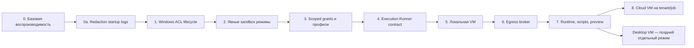
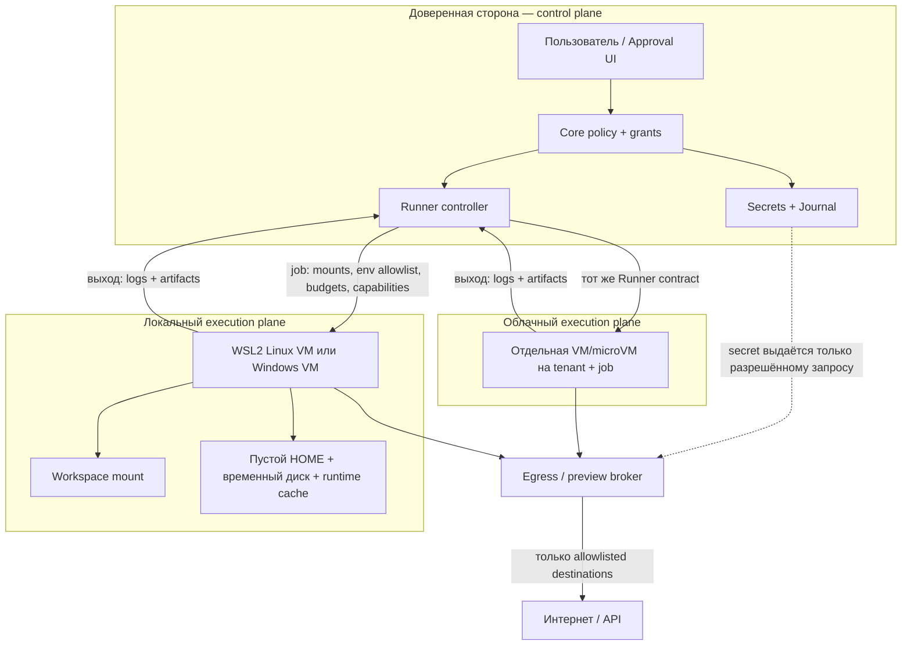

# План апгрейда sandbox и permission policy

Дата снимка: 18 ноября 2026. Это план для локального checkout `feat/ux-sidebar-composer`; статус GitHub PR в него не входит.

## Цель

Дать агенту широкие возможности **внутри явно выбранной рабочей среды**, сохранив узкую границу между агентом и пользовательской системой. Удобство достигается повторно используемыми профилями и короткоживущими разрешениями, а не постоянным снятием ограничений.

Основное правило: host core остаётся доверенным control plane; команды, плагины и пользовательский код выполняются в отдельном execution plane с явными mounts, сетью, лимитами и сроком жизни.

## Что подтвердил текущий снимок

- `packages/core/src/policy.ts` решает `allow` / `ask` / `deny` для tool и путей. Разрешение `shell.run` само по себе не описывает весь фактический доступ команды.
- Windows shell запускается через `packages/core/sandbox/ShellBox.exe`. Исходник `ShellBox.cs` использует постоянное имя `Sinty.Shell` и добавляет ACL через `icacls /grant`; отзыва ACL в исходнике нет. Это расходится с контрактом «грант только на команду» в `docs/spec/policy.md` и `docs/journal/2026-10-30-shell-path-grant.md`.
- Linux `shell.sandbox: auto` в `standard` режиме запускает host shell без bubblewrap, если `bwrap` отсутствует или probe не проходит. Это задокументированный fallback, но пользователь может не понять, что уровень изоляции изменился.
- macOS shell запускается без sandbox.
- `shellGrants()` распознаёт лишь часть путей из текста команды. Это полезная проверка для approval UX, но не граница безопасности: shell expansion, symlink, интерпретатор и дочерние инструменты могут обратиться к путям, которых парсер не увидел.
- Попытка запустить исходный `ShellBox.exe` в текущей среде возвращает `profile 80070002` из `CreateAppContainerProfile`, поэтому AppContainer integration test здесь не может подтвердить реальный запуск. Не менять и не публиковать security-critical бинарник без проверки на Windows-хосте, где профиль создаётся.

Подробные архитектурные замечания и сравнения подходов находятся в [обзоре архитектуры](architecture-review-2026-11-18.ru.md).

## Последовательность работ

Каждый пункт ниже — отдельный небольшой PR. PR обязан содержать сценарий успеха, сценарий отказа, проверку обратной совместимости и понятный откат. Не смешивать изменение enforcement с большим UX или VM-переездом.

### Шаг 0 — базовый снимок и воспроизводимость (сейчас)

**Сделано в этой сессии:** подтверждено чистое относительно пользователя состояние shell/policy-файлов перед началом; прочитаны `shell.ts`, `shell-sandbox.ts`, `ShellBox.cs`, policy spec и shell tests; зафиксированы четыре платформенных/семантических расхождения выше. Основная рабочая копия содержит много других незакоммиченных изменений, их не затрагиваем.

**Критерии:** записать для каждого поддерживаемого OS/backend фактические capabilities; запускать тесты исходника и staged executable; отдельно показывать «sandbox активен» и «host shell».

### Шаг 0a — убрать bearer token из постоянных startup logs

История локальных логов показывает UI URL с bearer token в fragment. Если этот token ещё активен — ротировать через штатный CLI. Затем изменить вывод `sinty web`, чтобы token не попадал в persistent stdout/stderr logs. Для личной машины с закрытым доступом к логам риск ниже; до шаринга логов или облачного/multi-user запуска это исправление обязательно. Проверить redaction на нормальном запуске и ошибке старта. Текущие логи не перепечатывать и token не использовать для автоматической авторизации.

- **Успех:** UI продолжает открываться, но bearer не пишется в persistent logs.
- **Отказ:** любой startup/error logger, содержащий token/fragment, обрезается или редактируется; server продолжает работать.
- **Совместимость:** интерактивный `sinty web` продолжает открывать UI; формат API не меняется.
- **Откат:** вернуть прежний вывод только в терминал текущего интерактивного запуска, но не в файлы логов; отозванный token не восстанавливать.

### Шаг 1 — временные Windows grants

Исправить постоянный ACL для Windows shell. Предпочтительный вариант — отдельная непереиспользуемая AppContainer identity на запуск с отзывом всех добавленных ACL и удалением профиля в `finally`. Любая ошибка выдачи ACL должна отказать в запуске. Если процесс был аварийно убит до cleanup, новый запуск всё равно не должен наследовать прежнюю identity. Проверить гонки параллельных shell-команд и ACL с наследованием.

- **Успех:** разрешённая папка читается во время команды; после завершения прежний SID больше не имеет эффективного доступа; следующий запуск не получает предыдущий grant.
- **Отказ:** ошибка создания профиля или выдачи ACL даёт ясный `sandbox_unavailable`/`grant_failed`; команда не стартует.
- **Совместимость:** существующие команды и карточка approval сохраняются; grants остаются read-only и на один запуск.
- **Откат:** вернуть прежний ShellBox бинарник и исходник одной версией; не менять файлы workspace и пользовательские ACL вручную.
- **Тесты:** Windows integration test на обычном, timeout, abort, параллельном запуске и ошибке cleanup; тестировать именно staged `.exe`, не только C#.

### Шаг 2 — честные и явные режимы sandbox

Уточнить `auto`/`off` и добавить явный режим host execution вместо скрытого fallback. `standard` по умолчанию должен сообщать фактическую границу до запуска. `strict` должен означать «не запускать shell без поддерживаемого sandbox». Для ОС без backend — понятный отказ, пока пользователь явно не выбрал host режим.

- **Успех:** при доступном backend изоляция включена и видна; без backend shell отказывает с конкретной причиной и инструкцией.
- **Отказ:** отсутствующий/сломанный backend не запускает host-команду в sandbox-required режиме.
- **Совместимость:** миграция старого `auto` сохраняет прежний сценарий только как явно отмеченный/выбранный host fallback; конфиг валидируется и объясняет смену поведения.
- **Откат:** вернуть старую интерпретацию `auto` через один config/feature gate релиз, не затрагивая policy rules.

### Шаг 3 — эффективный профиль доступа и короткие grants

Ввести ограниченный набор профилей поверх тех же capabilities: `Review`, `Workspace`, `Development`, `External action`. Добавить scope, срок, субъект, причину, журнал выдачи/отзыва. Например, разрешение на package registry до конца задачи не становится общим сетевым доступом или доверием ко всему shell.

- **Успех:** повторяемые безопасные действия в выбранном scope не требуют повторного подтверждения; пользователь видит, что именно сейчас разрешено.
- **Отказ:** истёкший/отозванный/неподходящий grant не проходит; `deny` и hard rules остаются сильнее.
- **Совместимость:** старые `allow/ask/deny` продолжают работать как базовые правила; новые профили — удобные presets, не новый bypass.
- **Откат:** отключить UI/preset слой; журнал и старые policy файлы остаются читаемыми.

### Шаг 4 — контракт Execution Runner

После фикса существующих границ определить интерфейс runner: `workspace`, read-only inputs, writable outputs, environment allowlist, network profile, CPU/RAM/PID/disk/time/output budgets, cancellation, session identity, artifacts, snapshot/restore. Контракт и `docs/spec` менять вместе. Core проверяет policy и выдаёт job capability; runner применяет ограничения и возвращает результат.

- **Успех:** один и тот же сценарий можно исполнить старым OS sandbox и VM runner через общий контракт.
- **Отказ:** несовместимый backend или невозможность применить лимит завершают job до старта.
- **Совместимость:** существующий ShellBox/bwrap оформляются как legacy providers; plugin SDK не получает host доступа.
- **Откат:** оставить интерфейс за feature flag и вернуть выбор старого provider.

### Шаг 5 — локальная VM для повседневной разработки

Первый локальный backend — Linux VM через WSL2 на Windows; отдельно оставить возможность Hyper-V/Windows Sandbox для задач, которым нужна Windows-среда. Core остаётся на host. VM получает только workspace mount, пустой HOME, временную файловую систему, runtime cache и лимиты. Ввод/вывод, preview-порты и clipboard проходят через узкий broker; host secrets и sockets не монтируются.

- **Успех:** агент ставит зависимости, запускает тесты/браузер и редактирует workspace; рестарт VM не теряет рабочие файлы; сброс snapshot удаляет временные последствия.
- **Отказ:** при остановленной/повреждённой VM job не переходит в host shell незаметно.
- **Совместимость:** старый shell остаётся доступен как явно выбранный backend на время миграции.
- **Откат:** переключить provider на прежнюю OS клетку; VM workspace можно оставить как обычную папку и не удалять автоматически.

### Шаг 6 — сеть через broker

Сеть закрыта по умолчанию. Пользователь может дать краткосрочный доступ к hostname/категории (например, registry) через egress broker. Broker контролирует DNS, redirect, порт, время и объём; секреты остаются в core и подставляются только на разрешённый destination. Не считать `policy.net.allow` защитой произвольных shell sockets.

- **Успех:** разрешённый registry работает, остальная сеть недоступна; запись показывает destination и инициировавшую задачу.
- **Отказ:** другой host, прямой IP, DNS rebinding, запрещённый redirect и истёкший grant блокируются.
- **Совместимость:** `ctx.fetch` сохраняет текущий контракт; shell network=true становится явным временным профилем.
- **Откат:** выключить broker и оставить сеть deny; core secret store не меняется.

### Шаг 7 — удобство работы с ресурсами

На основе runner-контракта добавить точечные возможности: нормализация cwd и symlink, безопасные path aliases, именованные pipes/loopback только через proxy, streaming/range downloads, управление temp/cache, project scripts и runtime checks. Каждую возможность включать отдельно, с лимитами и понятной карточкой доступа.

### Шаг 8 — облачный runner

Создавать отдельную VM/microVM на tenant + job/session с одноразовой identity. Control plane хранит policy, approvals, secrets и journal; execution plane получает только mounts и capabilities текущего job. Ограничить сеть egress proxy, CPU/RAM/PID/disk/time, размер логов и артефактов; уничтожать VM после TTL, persistent state хранить отдельными версионируемыми snapshots.

- **Успех:** один tenant не видит файлы, процессы, токены и сеть другого; остановленная задача не оставляет живых дочерних процессов.
- **Отказ:** сбой isolation provider или tenant identity закрывает запуск; нет fallback на общую host VM.
- **Совместимость:** локальный и cloud providers реализуют один Runner contract; plugin manifests не получают новые права автоматически.
- **Откат:** отключить cloud provider и вернуть задания в локальную очередь; snapshots экспортируемы и не привязаны к живой VM.

## Контур выполнения

## Что пока не делаем

- Не расширяем список постоянных filesystem/network разрешений «чтобы агенту не мешали».
- Не включаем произвольный host shell по умолчанию на всех платформах.
- Не добавляем desktop VM режим до завершения workspace/network broker и локального runner.
- Не переносим sandbox logic в плагины: enforcement должен оставаться в доверенном core/runner boundary.
- Не привязываем решение permission policy к LibreOffice или `slides.render`; это был отдельный пример инструментальной зависимости.

## Как предложения из исходного плана ложатся на этапы

| Предложение | Этап | Комментарий |
|---|---|---|
| Перенаправить `HOME`/`TEMP` в sandbox | 4–5 | Это свойство execution environment. Секреты и пользовательский профиль должны быть недоступны; кэш зависимостей выделяется отдельно и монтируется адресно. |
| Нормализовать `cwd` | 1 и 7 | Сначала исправить проверки существующей клетки; затем одинаково обрабатывать `..`, symlink/reparse point и Windows/Linux пути в runner contract. |
| Process-tree wrapper и отмена | 1 и 4 | Windows Job Object уже есть; проверить, что abort/timeout закрывает все потомки и сообщает `cancelled`/`timed_out` однозначно. |
| Scoped grants с TTL | 3 | Разрешения должны иметь субъект, ресурс, причину, срок и revoke; approval одной команды не означает доверие ко всему shell. |
| Egress allowlist | 6 | Применять через broker/VM boundary; policy на `ctx.fetch` не фильтрует произвольные shell sockets. |
| Named pipes и loopback | 5 и 7 | Давать только именованный канал и отдельные preview-порты через proxy. Не подключать host IPC и весь loopback namespace. |
| ASCII path alias | 7 | Добавлять только если подтверждена конкретная несовместимость инструмента с Unicode/длинными путями; alias должен указывать на ограниченный mount, не на корень профиля. |
| Streaming/range downloads | 7 | Делать ограниченный download API с лимитом размера, хоста, времени и проверкой redirect; не открывать shell прямой сети. |
| Error codes и safe retries | 2 и 4 | Различать `sandbox_unavailable`, `grant_denied`, `runner_start_failed`, timeout и отмену. Повторять только временную ошибку старта, не отказ политики. |
| Runtime tooling / Chromium | 5 | Устанавливать/кэшировать в versioned VM image или task cache; инструменты не должны расширять mounts до пользовательского профиля. |
| Project scripts | 7 | Показывать команду и side effects перед первым запуском; хранить scripts в проекте, запускать с теми же limits и grants. |
| Desktop VM mode | После 5–7 | Позже отдельный режим с явным доступом к экрану/вводу и отдельным approval для host clipboard, файлов и сети. |

## Следующее действие

Начать Шаг 1 с Windows integration harness на машине, где `CreateAppContainerProfile` успешно создаёт профиль, затем реализовать и проверить ACL lifecycle в исходнике и staged `ShellBox.exe`. Параллельно не менять пользовательский checkout вне перечисленных файлов и не включать новый режим по умолчанию до сценариев совместимости.
